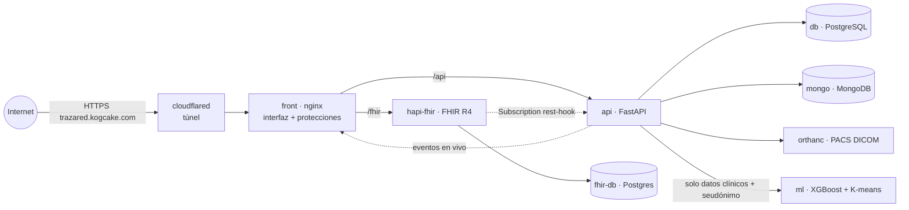
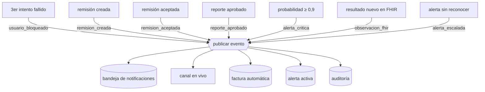

# TrazaRed HUV

**Trazabilidad de remisiones de pacientes para el Hospital Universitario del Valle
"Evaristo García".**

TrazaRed HUV registra cada remisión de un paciente de principio a fin: a qué instituciones
se contactó, qué respondieron, si había convenio con la EPS y qué tan urgente estaba el
paciente mientras esperaba. Además estima esa urgencia con un modelo de inteligencia
artificial que el médico revisa, guarda la información clínica en un estándar
interoperable (HL7 FHIR) y avisa en tiempo real a quien tiene que actuar.

**En línea:** https://trazared.kogcake.com

Proyecto de la asignatura Salud Digital, Universidad Autónoma de Occidente (2026-2).
**Equipo:** Luz Ángela Carabalí Mulato, Laura Daniela Astudillo Ortega, Nicolás Zapata
Obando y David Ortega Quintero.

---

## El problema

El HUV es el hospital público de alta complejidad de referencia del suroccidente
colombiano. Cuando un paciente necesita un servicio que el hospital no tiene disponible,
hay que remitirlo a otra institución con cupo y con convenio con su EPS. Hoy esa gestión
se hace caso a caso, llamada por llamada, sin un registro único: después nadie puede
demostrar qué instituciones fueron contactadas, qué respondieron ni cuánto tiempo pasó.
La Corte Constitucional documentó ese vacío en la Sentencia T-573 de 2023.

TrazaRed HUV convierte esa gestión en un proceso con rastro: cada remisión, cada intento de
contacto, cada cambio y cada decisión queda registrado, y nada se borra de verdad.

## Qué hace el sistema

- **Registra las remisiones completas:** paciente, institución de origen y destino,
  motivo, estado, convenio vigente, signos vitales y la bitácora de cada intento de
  contacto.
- **Cuida la historia clínica:** nada se elimina; las ediciones guardan la versión anterior,
  el "borrado" es lógico y solo el administrador restaura.
- **Separa lo que ve cada persona** según su rol, desde el administrador hasta el paciente.
- **Muestra imágenes médicas reales** (radiografías de tórax) desde la ficha del paciente,
  con un visor de brillo, contraste, negativo y zoom.
- **Estima la urgencia del paciente con IA** y deja la decisión al médico: el reporte queda
  pendiente hasta que lo aprueba o lo rechaza.
- **Protege los datos personales:** al modelo de IA nunca le llegan nombre, documento ni
  datos de contacto.
- **Remite entre médicos:** del médico tratante al especialista, con bandeja y aceptación.
- **Genera la historia clínica en PDF** solo con lo que el médico aprobó.
- **Lleva la facturación** de consultas, análisis de IA y remisiones.
- **Habla FHIR:** pacientes, remisiones y observaciones viven también en un servidor HL7
  FHIR R4 con códigos LOINC y SNOMED.
- **Reacciona solo:** avisos en vivo, bandeja de notificaciones, flujos automáticos y
  alertas críticas que escalan si nadie las atiende.
- **Deja auditoría** de quién hizo qué, sobre qué y cuándo.

## Arquitectura

Todo el sistema son nueve servicios en Docker que se levantan con un solo comando. Desde
internet solo se entra por un túnel de Cloudflare que llega a nginx, la única puerta: ahí
se aplican las protecciones. Las bases de datos, el servidor de imágenes y el servicio de
IA no se ven desde afuera.



| Servicio | Tecnología | Qué hace |
|---|---|---|
| `front` | nginx | Sirve la interfaz web y es la puerta única hacia la API y FHIR |
| `cloudflared` | Cloudflare Tunnel | Publica el sistema en internet con HTTPS, sin abrir puertos |
| `api` | Python · FastAPI | Usuarios y roles, pacientes, remisiones, IA, facturación, historia, eventos |
| `ml` | Python · XGBoost, scikit-learn | Modelo de urgencia y perfiles de pacientes; solo la API le habla |
| `db` | PostgreSQL | Pacientes, usuarios, remisiones, observaciones, reportes, alertas, auditoría |
| `mongo` | MongoDB | Bitácora de contactos de cada remisión y facturas |
| `orthanc` | Orthanc | Servidor de imágenes médicas (PACS) en formato DICOM |
| `hapi-fhir` y `fhir-db` | HAPI FHIR R4 · PostgreSQL | Servidor de interoperabilidad y su base |

**Por qué dos bases:** PostgreSQL guarda lo estructurado y relacionado (un paciente tiene
remisiones, una remisión tiene observaciones). MongoDB guarda lo que cambia de forma: los
intentos de contacto de cada remisión van como lista dentro de un solo documento, y las
facturas tienen campos distintos según el servicio.

## Roles

No hay registro público: solo el administrador crea cuentas y asigna roles.

| Rol | Qué ve y qué hace |
|---|---|
| **Admin** (Oficina de Referencia y Contrarreferencia) | Crea usuarios, desbloquea cuentas, restaura registros, consulta la auditoría y la contabilidad |
| **Médico** | Sus pacientes y remisiones, pide análisis de IA, aprueba o rechaza reportes, remite al especialista |
| **Especialista** | Las remisiones que le llegan, las acepta y también revisa reportes de IA |
| **Paciente** | Solo su propia información: a dónde y en cuánto tiempo será remitido |
| **EPS** | Las remisiones de sus afiliados, solo lectura |
| **Contable** | Crea, consulta y marca como pagadas las facturas; nunca ve datos clínicos |

## Seguridad

- **Bloqueo de cuenta** al tercer intento fallido: no entra ni con la contraseña correcta
  hasta que el administrador la desbloquea, y el administrador recibe el aviso en vivo.
- **Sesión obligatoria** en todas las rutas de datos (token JWT) y control de acceso por
  rol: lo que no le corresponde a un rol, se niega.
- **Contraseñas cifradas** con bcrypt.
- **Protecciones web:** CORS cerrado al dominio propio, cabeceras de seguridad y límite de
  peticiones por visitante.
- **Ningún secreto en el repositorio:** solo se publica `.env.example`; las claves reales
  se comparten por un canal privado.
- **Superficie mínima:** bases, PACS, FHIR y API solo escuchan dentro del equipo; el
  servicio de IA no se publica.
- **Datos hacia la IA seudonimizados:** antes de llamar al modelo se quitan nombre,
  documento, correo, teléfono y dirección; viajan solo las variables clínicas y un código
  que no permite volver al paciente. El mensaje exacto que se envió queda guardado y se
  puede consultar.
- **Auditoría** de inicios de sesión fallidos, bloqueos, creación de usuarios y pacientes,
  ediciones, borrados y restauraciones, análisis y aprobaciones de IA, remisiones,
  facturas, alertas y eventos FHIR.

## Datos

| Conjunto | Origen | Para qué |
|---|---|---|
| **600 remisiones** | Sintéticas, generadas con semilla fija | Poblar el sistema con casos en tres grupos según cómo terminó la remisión: efectiva, borderline y fallida |
| **600 radiografías de tórax** | Reales, NIH ChestX-ray14 (Wang et al., 2017) | Una por paciente, en el PACS; las remisiones fallidas tienen radiografía con hallazgo y las efectivas, sin hallazgo |
| **1 267 pacientes de urgencias** | Reales, dataset KTAS (Moon et al., PLOS ONE 2019, CC BY 4.0) | Entrenar y evaluar el modelo de urgencia |
| **190 pacientes sintéticos** | Generados dentro de 4 perfiles de pacientes reales | Poblar el sistema sin exponer pacientes reales; marcados como sintéticos y nunca usados para entrenar |

Fuentes, licencias y el detalle de cada conjunto: [`docs/DATASETS.md`](docs/DATASETS.md) y
[`docs/README.md`](docs/README.md).

## Inteligencia artificial

**Perfiles de pacientes.** Con K-means se encontraron cuatro perfiles en los pacientes de
urgencias: hipoxemia severa, presión arterial alta, sin dolor y jóvenes con dolor. Se
compararon cuatro algoritmos de agrupamiento y se identificaron las zonas donde el modelo
más se confunde.

**Modelo de urgencia.** Se compararon 11 modelos con el mismo preprocesamiento y la misma
validación cruzada; ganó **XGBoost**. Para cada paciente entrega una probabilidad de ser
urgente:

- Desde **0,4** lo considera urgente: en 254 pacientes que nunca vio detectó 130 de 147
  urgentes (sensibilidad 88 %, especificidad 51 %, precisión 71 %, F1 0,79).
- Desde **0,9** enciende una **alerta crítica**: en la prueba saltó en 31 pacientes y 28
  eran urgentes.
- **Sesgo conocido:** casi todos los urgentes que se le escapan son menores de 65 años.

**La IA sugiere, el médico decide.** Cada análisis crea un reporte pendiente. Solo el
médico o el especialista lo aprueba o lo rechaza, con sus observaciones; lo aprobado entra
a la historia clínica y lo rechazado se conserva como evidencia.

El entrenamiento completo está en `notebooks/semana9_final.ipynb` y el modelo se puede
reentrenar desde la API.

## Flujo clínico

1. El médico abre la ficha del paciente: datos, signos vitales, radiografía y remisiones.
2. Pide el análisis de IA; el reporte queda pendiente y, si la probabilidad es muy alta,
   salta la alerta crítica.
3. Revisa el reporte y lo aprueba o lo rechaza. Al aprobarlo se genera la factura del
   análisis.
4. Si hace falta, remite al especialista con un motivo; el especialista recibe el aviso, la
   ve en su bandeja y la acepta.
5. La historia clínica se descarga en PDF con todo lo aprobado.
6. Cuando llega un resultado nuevo al servidor FHIR (por ejemplo, una glucosa de
   laboratorio), el médico responsable recibe el aviso.

## Sistema reactivo

La información llega sola a quien la necesita, sin recargar la página:

- **Canal en vivo** que respeta los roles: el paciente y el contable no reciben eventos
  clínicos.
- **Bandeja de notificaciones** y contadores de pendientes (reportes por revisar,
  remisiones recibidas, alertas activas).
- **Flujos automáticos:** remitir avisa al especialista, aceptar avisa al médico, aprobar
  un reporte crea la factura y un bloqueo avisa al administrador.
- **Alertas críticas** que se quedan en pantalla hasta que un médico las reconoce; si nadie
  lo hace en 10 minutos, se escalan al administrador.

El catálogo de eventos está en [`docs/EVENTOS.md`](docs/EVENTOS.md).



## Interoperabilidad

| Dato en TrazaRed | Recurso HL7 FHIR R4 | Codificación |
|---|---|---|
| Paciente | `Patient` | Documento como identificador |
| Remisión entre instituciones | `Encounter` | Origen, destino y estado |
| Signo vital u observación | `Observation` | LOINC y unidades UCUM |
| Remisión de médico a especialista | `ServiceRequest` | SNOMED CT (306206005, remisión a servicio) |

Al arrancar, la API crea una suscripción en el servidor FHIR para enterarse cuando llega
una observación nueva. El mapeo campo por campo está en
[`documentacion_mapeo_roles.md`](documentacion_mapeo_roles.md).

## Marco normativo

| Norma | Qué exige | Cómo lo cumple TrazaRed |
|---|---|---|
| Ley 1581 de 2012 (protección de datos) | Finalidad, circulación restringida y seguridad de los datos personales | Seudonimización hacia la IA, acceso por rol, contable sin datos clínicos, auditoría |
| Ley 2015 de 2020 (historia clínica electrónica interoperable) | Historia clínica que se pueda intercambiar entre prestadores | Servidor FHIR R4 con LOINC y SNOMED, historia clínica en PDF |
| Resolución 866 de 2021 | Datos clínicos mínimos para la interoperabilidad | Recursos `Patient`, `Encounter`, `Observation` y `ServiceRequest` codificados |
| Resolución 1995 de 1999 (historia clínica) | Confidencialidad, integridad y custodia; los registros no se destruyen | Borrado lógico con restauración, historial de ediciones, reportes rechazados conservados |
| Resolución 3100 de 2019 (habilitación) | Registros y procesos de atención trazables | Remisión entre médicos trazable y registro de quién hizo qué y cuándo |

## Estructura del repositorio

```
TrazaRedHUV/
├── .env.example              # Plantilla de variables (las claves reales nunca se suben)
├── tester.yaml               # Datos para la verificación automática del sistema
├── db/                       # Esquema de PostgreSQL (se aplica solo al arrancar)
├── docker/                   # docker-compose.yml (9 servicios) y nginx.conf
├── python/                   # API: auth, remisiones, ia, historia, contabilidad,
│                             # eventos, fhir_sync, pacs y scripts de carga de datos
├── ml/                       # Servicio de IA: modelo XGBoost, perfiles y entrenamiento
├── frontend/                 # Interfaz web de una sola página (HTML, CSS, JS)
├── data/                     # Dataset de las 600 remisiones (CSV)
├── docs/                     # Datasets, eventos, contabilidad y documentos del proyecto
├── notebooks/                # Cuadernos: proyecto, dataset y modelos
├── pruebas/                  # Pruebas automáticas del sistema
├── evidencia_endpoints/      # Capturas de funcionamiento
├── levantar_demo.py          # Demo ligera sin Docker (bases en la nube)
└── documentacion_mapeo_roles.md  # Mapeo a FHIR y justificación de roles
```

## Cómo ejecutarlo

Requisitos: Docker Desktop (con Docker Compose 2.24 o más nuevo) y Python 3.10+ para las
pruebas y los cuadernos.

**1. Configurar las variables.** En la raíz del proyecto copia la plantilla y llénala con
las claves que comparte el equipo por el canal privado:

```powershell
copy .env.example pass.env
```

`pass.env` (o `.env`) nunca se sube al repositorio. Variables opcionales: `TUNNEL_TOKEN`
para el dominio fijo, `ESCALAMIENTO_SEGUNDOS` (600 por defecto) y `VALOR_ANALISIS_IA`
(80 000 COP por defecto).

**2. Levantar el sistema:**

```powershell
cd docker
docker compose up -d --build
docker compose ps
```

Al arrancar, la API crea las tablas, un usuario de prueba por rol y la suscripción FHIR.

**3. Cargar los datos** (solo la primera vez):

```powershell
docker compose exec api python cargar_dataset.py
docker compose run --rm -v RUTA\datos_imagenes:/datos_imagenes:ro api python sembrar_imagenes_reales.py --max 600
```

`RUTA\datos_imagenes` es la carpeta donde descargaste las imágenes del NIH (`images_001`) y
`Data_Entry_2017_v2020.csv`.

**4. Publicarlo en internet.** Con `TUNNEL_TOKEN` en el archivo de variables:

```powershell
docker compose --profile tunel-fijo up -d
docker compose stop cloudflared
```

Sin token, `docker compose logs cloudflared` muestra una URL temporal de `trycloudflare.com`.

**5. Verificar:**

```powershell
pip install -r requirements.txt
python pruebas\probar_persona1.py      # acceso, seguridad, Docker, túnel y auditoría
python pruebas\probar_persona2.py      # IA, perfiles, seudonimización, reportes y facturas
python pruebas\probar_persona4.py      # canal en vivo, notificaciones y alertas
```

En tu equipo, la interfaz queda en **http://localhost:8080** y la documentación de la API en
http://localhost:8000/docs.

## Usuarios de demostración

Todos los datos de pacientes son sintéticos o de datasets públicos.

| Rol | Usuario | Contraseña |
|---|---|---|
| Admin | `admin@trazared.huv` | `DEMO_ADMIN_PASSWORD` |
| Médico | `medico@huv.gov.co` | `DEMO_MEDICO_PASSWORD` |
| Especialista | `especialista@huv.gov.co` | `DEMO_ESPECIALISTA_PASSWORD` |
| Contable | `contable@huv.gov.co` | `DEMO_CONTABLE_PASSWORD` |
| Paciente | `paciente@correo.com` | `DEMO_PACIENTE_PASSWORD` |
| EPS (Coosalud) | `eps@coosalud.com` | `DEMO_EPS_PASSWORD` |

Las contraseñas son las de las variables indicadas en el archivo de variables; no están en
el repositorio.

## Documentación

- [`docs/DATASETS.md`](docs/DATASETS.md): datos, perfiles, modelo, umbrales, sesgo y
  limitaciones.
- [`docs/EVENTOS.md`](docs/EVENTOS.md): eventos, flujos automáticos y alertas.
- [`docs/CONTABILIDAD.md`](docs/CONTABILIDAD.md): estructura de las facturas.
- [`docs/README.md`](docs/README.md): dataset de las 600 remisiones.
- [`documentacion_mapeo_roles.md`](documentacion_mapeo_roles.md): mapeo a FHIR y roles.
- `docs/TrazaRed_HUV.pdf`: documento del proyecto.
