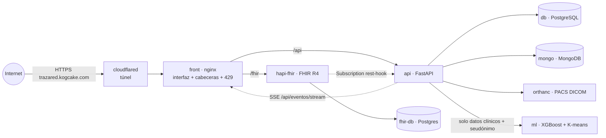
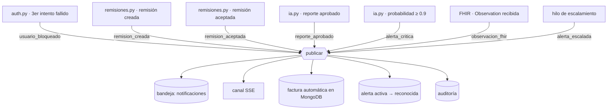

# TrazaRed HUV

Sistema de trazabilidad para la remisión y el traslado de pacientes del Hospital
Universitario del Valle "Evaristo García" (HUV), desarrollado para la asignatura de
Salud Digital (2026-2). El proyecto se construyó por etapas: en el **Corte 1** se dejó
cada remisión registrada e interoperable; en la **semana 8** el sistema se empaquetó en
Docker y recibió un dataset con sentido clínico; y en el **Corte 2** se puso en
internet de forma segura, con inteligencia artificial que el médico revisa y con
reacciones automáticas en tiempo real. Este README describe el sistema completo tal
como está hoy.

**En línea:** https://trazared.kogcake.com

**Equipo:** Luz Ángela Carabalí Mulato, Laura Daniela Astudillo Ortega, Nicolás Zapata
Obando, David Ortega Quintero.

## El problema

El HUV es el hospital público de alta complejidad de referencia del suroccidente
colombiano. Cuando un paciente necesita un servicio que no está disponible, hay que
remitirlo a otra institución con cupo y con convenio con su EPS. Hoy esa gestión se hace
caso a caso, llamada por llamada, sin un registro único que confirme qué instituciones
fueron contactadas, qué respondieron, si existía convenio vigente ni qué tan urgente era
el paciente; es un vacío documentado en la Sentencia T-573 de 2023 de la Corte
Constitucional.

TrazaRed HUV registra cada remisión de principio a fin, estima la urgencia de cada
paciente con un modelo de IA que el médico revisa, y avisa en tiempo real a quien tiene
que actuar.

## Recorrido del proyecto

### Corte 1 · La remisión queda registrada e interoperable

El primer objetivo fue que ninguna remisión se perdiera. Se diseñó un modelo de datos
en dos bases que se complementan:

- **PostgreSQL** guarda lo estructurado: `pacientes`, `usuarios`, `remisiones` (institución
  de origen y destino, fecha, motivo, estado y convenio vigente), `observaciones` (signos
  vitales con código LOINC y unidad UCUM), `remisiones_historial` y `auditoria`.
- **MongoDB** guarda la colección `gestiones_contacto`: la bitácora de intentos de contacto
  de cada remisión (a quién se llamó, qué respondió, cuándo), como lista anidada dentro de
  un documento por remisión.

Encima se construyó una **API en FastAPI con JWT** y cuatro roles pensados desde el
hospital: **admin** (Oficina de Referencia y Contrarreferencia), **médico**, **EPS** (sigue
las remisiones de sus afiliados) y **paciente** (solo ve a dónde y en cuánto tiempo será
remitido). Desde este corte la historia no se destruye: el médico edita con historial
(`soft_edit`, la versión anterior queda en `remisiones_historial`) y "borra" con
**soft delete**; solo el admin restaura, y cada acción queda en la auditoría.

Para la interoperabilidad se montó un servidor **HAPI FHIR R4** y se hizo el mapeo campo
por campo: `pacientes` → `Patient`, `remisiones` → `Encounter`, `observaciones` →
`Observation` (LOINC). El mapeo, sus desviaciones del plan y la justificación de los roles
están en [`documentacion_mapeo_roles.md`](documentacion_mapeo_roles.md). La demo de ese
corte (bases en Neon y Atlas, HAPI en Docker y túneles rápidos de Cloudflare) se levanta
con `python levantar_demo.py`, y el recorrido está en `notebooks/proyecto_trazared_huv.ipynb`.

### Semana 8 · Docker, bloqueo y un dataset con sentido

El sistema se **dockerizó** para levantarse con un solo comando, sin depender de bases en
la nube ni de pasos manuales. Se agregó el **bloqueo de cuenta al tercer intento fallido**
y un servidor de imágenes médicas **Orthanc (PACS)**, primero con imágenes de prueba.

Se generó el **dataset del proyecto: 600 remisiones sintéticas** (semilla fija) alrededor
de tres grupos definidos por cómo terminó la remisión, con distribuciones que se traslapan
a propósito para que el agrupamiento tuviera algo real que encontrar:

| Grupo | n | Cómo terminó | Contactos | Convenio vigente | Signos del paciente |
|---|---|---|---|---|---|
| `efectiva` | 200 | aceptada / completada | 1–2 | ~85 % | casi normales |
| `borderline` | 200 | pendiente / en gestión | 3–4 | ~50 % | intermedios |
| `fallida` | 200 | rechazada | 4–7 | ~15 % | alterados (taquicardia, hipotensión, SpO2 y Glasgow bajos) |

Los CSV están en `data/` y su descripción en [`docs/README.md`](docs/README.md). El cuaderno
de esa semana es `notebooks/semana8_docker_bloqueo_dataset.ipynb`.

### Corte 2 · Seguro, en línea, con IA y reactivo

Sobre esa base, el Corte 2 cubrió los 22 requisitos de la rúbrica en cuatro frentes:

- **Acceso y seguridad:** cinco roles (se suman especialista y contable; la EPS se
  conserva), bloqueo con aviso al admin, token y control por rol en todas las rutas,
  CORS cerrado, cabeceras de seguridad, límite de peticiones, ningún secreto en el
  repositorio, nueve servicios en Docker y el sistema publicado en
  **trazared.kogcake.com** con un túnel de Cloudflare.
- **Datos e IA:** 600 radiografías de tórax reales (NIH ChestX-ray14) reemplazan las de
  prueba, coherentes con el grupo de cada remisión; el dataset real de urgencias KTAS
  (1 267 pacientes) para entrenar; 11 modelos comparados y **XGBoost** como ganador; 4
  perfiles con K-means y 190 pacientes sintéticos; y una capa que quita los datos
  personales antes de llamar al modelo.
- **Flujo clínico:** remisión de médico a especialista, reportes de IA que el médico
  aprueba o rechaza, historia clínica en PDF, facturación en MongoDB y FHIR que avisa al
  médico cuando llega un dato nuevo.
- **Sistema reactivo:** canal en vivo, bandeja de notificaciones, flujos automáticos y
  alertas críticas que escalan al admin si nadie las reconoce.

El detalle requisito por requisito está en la tabla siguiente.

## Qué se hizo en el Corte 2, requisito por requisito

| Bloque | Requisito | Qué quedó funcionando | Dónde |
|---|---|---|---|
| Acceso y seguridad | R01 | Cinco roles (admin, médico, especialista, paciente, contable); solo el admin crea usuarios; `GET /me` devuelve el rol | `python/auth.py` |
| | R02 | Bloqueo al 3er intento fallido (423), solo el admin desbloquea, aviso al admin | `python/auth.py`, `python/eventos.py` |
| | R03 | Token en todas las rutas, control por rol, bcrypt, CORS cerrado, cabeceras de seguridad, límite 429, solo `.env.example` en el repo | `python/main.py`, `docker/nginx.conf` |
| | R04 | Túnel de Cloudflare como servicio del compose, con dominio propio | `docker/docker-compose.yml` |
| | R05 | Un solo `docker compose up -d` levanta todo, incluido el servicio `ml` | `docker/docker-compose.yml`, `ml/Dockerfile` |
| Datos | R06 | 600 radiografías reales de tórax (NIH ChestX-ray14) en el PACS | `python/sembrar_imagenes_reales.py`, `docs/DATASETS.md` |
| | R07 | Dataset real KTAS, 4 perfiles con K-means y 190 pacientes sintéticos dentro de cada perfil | `ml/agrupacion.py`, `docs/DATASETS.md` |
| Flujo clínico | R08 | Remisión de médico a especialista, bandeja y aceptación | `python/remisiones.py` (`/remitir`) |
| | R09 | Facturación en MongoDB (colección `facturas`) | `python/contabilidad.py`, `docs/CONTABILIDAD.md` |
| | R10 | Reporte de IA en estado `pendiente`, que el médico o especialista aprueba o rechaza | `python/ia.py` |
| | R11 | Historia clínica en JSON y en PDF, solo con reportes aprobados | `python/historia.py` |
| | R12 | Capa que quita los datos personales antes de llamar al modelo; payload consultable | `python/ia.py` |
| | R13 | Auditoría con usuario, acción, recurso y fecha | `python/auth.py` |
| | R14 | Soft delete del médico y restauración solo del admin | `python/remisiones.py` |
| | R15 | Pacientes en HAPI FHIR con LOINC y SNOMED | `python/fhir_sync.py` |
| | R16 | Interfaz de una sola página, sin recargas, con canal en vivo | `frontend/` |
| Sistema reactivo | R17 | Canal en tiempo real por Server-Sent Events | `python/eventos.py` |
| | R18 | Bandeja de notificaciones y contadores de pendientes | `python/eventos.py` |
| | R19 | Cuatro flujos automáticos (remitir, aceptar, aprobar reporte, bloqueo) | `python/eventos.py`, `docs/EVENTOS.md` |
| | R20 | Alertas críticas con reconocimiento y escalamiento | `python/eventos.py`, `frontend/js/alertas.js` |
| | R21 | Subscription `rest-hook` de HAPI FHIR que avisa al médico | `python/fhir_sync.py`, `python/main.py` |
| Documentación | R22 | Este README, `docs/DATASETS.md`, `docs/EVENTOS.md`, `docs/CONTABILIDAD.md` y el mapa de leyes de abajo | `README.md`, `docs/` |

## Arquitectura

Un solo `docker compose up -d` levanta los nueve servicios (R05). Desde internet solo se
entra por el túnel de Cloudflare, que llega a nginx: ahí se aplican las cabeceras de
seguridad y el límite de peticiones (R03). Las bases, el PACS y el servicio de IA no
están expuestos hacia afuera.



| Servicio | Imagen | Puerto en tu equipo | Qué hace |
|---|---|---|---|
| `front` | nginx:alpine | **8080** | Interfaz (SPA) y puerta única: `/api` → api, `/fhir` → hapi-fhir, SSE sin buffer |
| `cloudflared` / `cloudflared-fijo` | cloudflare/cloudflared | 127.0.0.1:2000 (métricas) | Túnel HTTPS público hacia `front` (R04) |
| `api` | propia (`python/Dockerfile`) | 127.0.0.1:8000 | FastAPI: roles, pacientes, remisiones, IA, contabilidad, historia, eventos |
| `ml` | propia (`ml/Dockerfile`) | — (solo interno) | Modelo de urgencia y agrupamiento; solo la api le habla (`http://ml:8001`) |
| `db` | postgres:16 | 127.0.0.1:5434 | Base relacional (`db/schema.sql`, `db/migracion_persona3.sql`) |
| `mongo` | mongo:7 | 127.0.0.1:27017 | Gestiones de contacto y facturas |
| `orthanc` | orthancteam/orthanc | 127.0.0.1:8042 | PACS: imágenes médicas DICOM |
| `hapi-fhir` / `fhir-db` | hapiproject/hapi · postgres:15 | 127.0.0.1:8081 / 5433 | Servidor FHIR R4 y su base |

nginx busca la dirección de `api` y `hapi-fhir` en el DNS interno de Docker en cada
petición, así que reconstruir la API no deja a la interfaz con un 502.

### Diagrama de eventos

El módulo que detecta un hecho llama a `publicar()` (en `python/eventos.py`), y de ahí
salen la bandeja, el canal en vivo y las reacciones automáticas. El catálogo completo
está en [`docs/EVENTOS.md`](docs/EVENTOS.md).



## Estructura del repositorio

```
TrazaRedHUV/
├── .env.example                  # Plantilla de variables (el .env / pass.env real NUNCA se sube)
├── tester.yaml                   # Contrato de verificación para el tester del profesor
├── db/
│   ├── schema.sql                # Esquema de PostgreSQL (idempotente; la API lo aplica al arrancar)
│   └── migracion_persona3.sql    # Remisiones médicas y PDF (también se aplica al arrancar)
├── docker/
│   ├── docker-compose.yml        # Los 9 servicios, más el túnel con nombre (perfil tunel-fijo)
│   └── nginx.conf                # Puerta única: cabeceras, límite 429, /api, /fhir, SSE
├── python/                       # API (FastAPI)
│   ├── main.py                   # Arma la app: CORS, cabeceras, routers, pacientes, imágenes, receptor FHIR
│   ├── auth.py                   # Conexiones, login con bloqueo, roles, /me, usuarios, auditoría
│   ├── remisiones.py             # Remisiones, soft delete, observaciones, contactos y /remitir (R08)
│   ├── ia.py                     # Análisis de IA, seudonimización, aprobación, clusters (R07, R10, R12)
│   ├── historia.py               # Historia clínica en JSON y PDF (R11)
│   ├── contabilidad.py           # Facturación en MongoDB (R09)
│   ├── eventos.py                # publicar(), SSE, notificaciones, pendientes, alertas (R17–R20)
│   ├── fhir_sync.py              # PostgreSQL → FHIR y Subscription rest-hook (R15, R21)
│   ├── pacs.py                   # Cliente de Orthanc
│   ├── cargar_dataset.py         # Dataset de remisiones del proyecto
│   ├── sembrar_imagenes.py       # Imágenes sintéticas (semana 8)
│   ├── sembrar_imagenes_reales.py# Radiografías reales NIH ChestX-ray14 (R06)
│   └── Dockerfile
├── ml/                           # Servicio de IA
│   ├── main.py                   # /health, /modelo, /predecir, /entrenar, /clusters
│   ├── entrenar.py               # Entrenamiento reproducible del modelo (POST /entrenar)
│   ├── agrupacion.py             # Perfiles K-means y pacientes sintéticos
│   ├── modelo/ktas_modelo.joblib # Modelo XGBoost entrenado
│   └── Dockerfile
├── frontend/                     # Interfaz (HTML + CSS + JS, una sola página)
├── data/                         # Dataset de remisiones del proyecto (CSV)
├── docs/                         # DATASETS.md, EVENTOS.md, CONTABILIDAD.md, README del dataset
├── notebooks/                    # Corte 1, semana 8 y semana9_final.ipynb (modelos y agrupamiento)
├── pruebas/                      # probar_persona1.py, probar_persona2.py, probar_persona4.py
├── evidencia_endpoints/          # Capturas: soft delete del médico y restauración del admin (R14)
├── levantar_demo.py              # Demo del Corte 1 sin Docker
└── documentacion_mapeo_roles.md  # Mapeo BD → FHIR y justificación de roles (copia en docs/)
```

## Despliegue paso a paso

Requisitos: **Docker Desktop** corriendo (Docker Compose 2.24 o más nuevo) y Python 3.10+
para las pruebas y los cuadernos.

**1. Variables de entorno.** En la raíz del proyecto, copia la plantilla y llénala con
los valores que el equipo comparte por el canal privado:

```powershell
copy .env.example pass.env
```

La API y el compose leen `.env` y, si no existe, `pass.env`. Ninguno se sube nunca al
repositorio. Además de las variables de la plantilla, el sistema acepta:

| Variable | Para qué | Por defecto |
|---|---|---|
| `TUNNEL_TOKEN` | Túnel con nombre de Cloudflare (dominio fijo) | — |
| `ESCALAMIENTO_SEGUNDOS` | Tiempo para escalar una alerta crítica no reconocida | 600 (10 min) |
| `VALOR_ANALISIS_IA` | Valor de la factura automática del análisis de IA | 80000 COP |

**2. Levantar todo:**

```powershell
cd docker
docker compose up -d --build
docker compose ps                                   # 9 servicios en "running"
```

Al arrancar, la API aplica `db/schema.sql` y `db/migracion_persona3.sql`, crea un
usuario de prueba por rol con las contraseñas `DEMO_*` y crea la Subscription de FHIR.

**3. Cargar los datos** (solo la primera vez):

```powershell
docker compose exec api python cargar_dataset.py
# Radiografías reales: descargar images_001 y Data_Entry_2017_v2020.csv del NIH en una carpeta
docker compose run --rm -v RUTA\datos_imagenes:/datos_imagenes:ro api python sembrar_imagenes_reales.py --max 600
```

**4. Publicar en el dominio.** Con `TUNNEL_TOKEN` en el `.env`, se usa el túnel con
nombre en lugar del túnel rápido:

```powershell
docker compose --profile tunel-fijo up -d
docker compose stop cloudflared
```

Sin token, el servicio `cloudflared` da una URL temporal
(`docker compose logs cloudflared | findstr trycloudflare`).

**5. Verificar** (desde la raíz, con el entorno de Python activo):

```powershell
pip install -r requirements.txt
python pruebas\probar_persona1.py      # roles, bloqueo, seguridad, Docker, túnel, auditoría
python pruebas\probar_persona2.py      # modelo, clusters, seudonimización, reportes, factura
python pruebas\probar_persona4.py      # canal en vivo, bandeja, pendientes, alertas
```

Local: interfaz en **http://localhost:8080** y documentación de la API en
http://localhost:8000/docs.

## Roles y permisos (R01)

Solo el `admin` crea usuarios y asigna roles; no existe registro público.

| Rol | Ve y hace | No puede |
|---|---|---|
| `admin` | Usuarios, desbloqueos, restauración, auditoría, contabilidad | Aprobar reportes de IA |
| `medico` | Pacientes, IA, aprobar o rechazar reportes, remitir, soft delete de lo suyo | Ver la auditoría, restaurar, crear usuarios |
| `especialista` | Remisiones recibidas, aceptarlas, aprobar reportes | Ver la auditoría, crear usuarios |
| `paciente` | Solo su propia información | Ver a otros pacientes (404), remitir, aprobar reportes |
| `contable` | Crear, listar y marcar como pagadas las facturas | Ver datos clínicos ni la historia (403) |
| `eps` | (Corte 1) Seguir las remisiones de sus afiliados, solo lectura | Modificar |

## Seguridad (R02, R03, R12)

- **Bloqueo:** al 3er intento fallido la cuenta queda bloqueada (423) y no entra ni con la
  clave correcta. Solo el admin desbloquea, y el admin recibe el aviso en vivo.
- **Token en todas las rutas de datos:** sin token, 401. **Control por rol:** 403.
- **Contraseñas** con hash bcrypt, nunca en texto plano.
- **CORS restringido** a `CORS_ORIGINS`, sin `*` y sin reflejar orígenes desconocidos.
- **Cabeceras:** `X-Content-Type-Options: nosniff`, `X-Frame-Options: DENY` y
  `Referrer-Policy: no-referrer`; nginx no anuncia su versión.
- **Límite de peticiones:** 10 por segundo (ráfagas de 20) por IP real del visitante; si
  se pasa, 429.
- **Secretos:** en el repositorio solo está `.env.example`.
- **Superficie mínima:** bases, PACS, FHIR y API solo en `127.0.0.1`; `ml` no se publica.
- **Datos hacia la IA (R12):** antes de llamar al modelo, la API quita nombre, documento,
  correo, teléfono y dirección. Al modelo solo le llegan las variables clínicas y un
  seudónimo (HMAC del id del paciente, no reversible). El payload exacto queda guardado
  en `GET /ia/reportes/{id}/payload`.

## Datos (R06, R07)

- **Imágenes:** 600 radiografías de tórax reales del NIH ChestX-ray14, una por paciente,
  guardadas como DICOM en Orthanc y visibles desde la ficha con un visor de brillo,
  contraste, negativo, zoom y desplazamiento.
- **Tabular:** dataset real KTAS (Moon et al., PLOS ONE 2019, CC BY 4.0), 1 267
  pacientes de dos urgencias de Corea.
- **Perfiles:** K-means con k = 4 (comparado con jerárquico, GMM y DBSCAN): hipoxemia
  severa, presión arterial alta, sin dolor y general. Zonas de confusión: "general" por
  urgentes perdidos y "sin dolor" por falsas alarmas.
- **Sintéticos:** 190, generados dentro de cada perfil y marcados con `origen = sintetico`;
  el 96.8 % se reconoce en su perfil. No se usan para entrenar ni evaluar.

El detalle completo, con fuentes, licencias y la justificación del número de grupos,
está en [`docs/DATASETS.md`](docs/DATASETS.md).

## Modelo de IA (R10, R20, R22)

- Se compararon **11 modelos** con el mismo preprocesamiento y las mismas 5 particiones
  de validación cruzada. Ganó **XGBoost** (AUC 0.833 ± 0.007).
- Prueba con 254 pacientes nunca vistos: AUC 0.765, sensibilidad 0.884, especificidad
  0.514, precisión 0.714, F1 0.790.
- **Umbral de decisión 0.4:** detecta casi 9 de cada 10 urgentes. **Umbral crítico 0.9:**
  dispara la alerta; en la prueba saltó en 31 de 254 pacientes y el 90 % eran urgentes.
- **Sesgo:** de los 17 urgentes perdidos, 15 son menores de 65 años.
- Cada análisis crea un reporte `pendiente`; solo los aprobados llegan a la historia
  clínica y al PDF, y los rechazados se conservan como evidencia.
- El modelo se puede reentrenar desde la API (`POST /entrenar`, solo admin) y cada
  reentrenamiento sube la versión.

Métricas, umbrales, sesgo y limitaciones: [`docs/DATASETS.md`](docs/DATASETS.md) y
`notebooks/semana9_final.ipynb`.

## Flujo clínico (R08, R09, R11, R15, R21)

- **Remisión entre médicos:** `POST /remitir` (médico → especialista con motivo),
  `GET /remitir/bandeja` y `POST /remitir/{id}/aceptar`.
- **Contabilidad:** facturas en MongoDB con paciente, servicio, valor, fecha y estado de
  pago; las del análisis de IA se crean solas al aprobar el reporte
  ([`docs/CONTABILIDAD.md`](docs/CONTABILIDAD.md)).
- **Historia clínica:** `GET /pacientes/{id}/historia` y `/historia.pdf`, solo con
  reportes aprobados.
- **FHIR:** `fhir_sync.py` publica `Patient`, `Encounter` y `Observation` con LOINC y
  SNOMED. Al arrancar, la API crea una `Subscription` rest-hook; cuando llega una
  `Observation` nueva (por ejemplo glucosa, LOINC 2339-0), el médico responsable recibe el
  aviso y el evento queda auditado con origen FHIR.

| Tabla PostgreSQL | Recurso FHIR |
|---|---|
| `pacientes` | `Patient` |
| `remisiones` | `Encounter` |
| `observaciones` | `Observation` |

## Sistema reactivo (R16–R20)

- **Canal en vivo:** `GET /api/eventos/stream?token=…` (Server-Sent Events). Llega en
  menos de 8 s y solo a quien le corresponde; el paciente y el contable no reciben eventos
  clínicos.
- **Bandeja y pendientes:** `GET /notificaciones`, `POST /notificaciones/{id}/leer` y
  `GET /pendientes` (reportes por revisar, remisiones recibidas, alertas activas).
- **Flujos automáticos:** remitir avisa al especialista; aceptar avisa al médico; aprobar
  un reporte crea la factura; un bloqueo avisa al admin.
- **Alertas críticas:** barra persistente hasta que un médico o especialista la reconoce
  con una nota (`POST /alertas/{id}/reconocer`). Si nadie la reconoce en 10 minutos, se
  escala al admin.

## Auditoría (R13)

Solo el admin consulta `GET /auditoria`. Cada fila trae usuario, acción, recurso y fecha,
con filtros por acción, usuario y recurso. Se registran, entre otras: login fallido,
bloqueo y desbloqueo, creación de usuario y de paciente, análisis de IA, aprobación o
rechazo, remisión, factura, alerta crítica y su reconocimiento, evento FHIR, soft delete
y restauración.

## Mapa de requisitos a leyes

| Norma | Qué exige | Control técnico en TrazaRed |
|---|---|---|
| Ley 1581 de 2012 (habeas data) | Finalidad, circulación restringida y seguridad de los datos personales | Seudonimización hacia la IA (R12), control por rol (R01, R03), contable sin datos clínicos, auditoría (R13) |
| Ley 2015 de 2020 (historia clínica electrónica interoperable) | Historia clínica electrónica que se pueda intercambiar entre prestadores | Servidor FHIR R4 con LOINC y SNOMED (R15), FHIR reactivo (R21), historia en PDF (R11) |
| Resolución 866 de 2021 | Elementos de datos clínicos relevantes para la interoperabilidad | Recursos `Patient`, `Encounter` y `Observation` codificados en FHIR |
| Resolución 1995 de 1999 (manejo de la historia clínica) | Confidencialidad, integridad y custodia; los registros no se borran | Soft delete y restauración (R14), reportes rechazados conservados (R10), acceso por rol y auditoría |
| Resolución 3100 de 2019 (habilitación) | Estándares de historia clínica, registros y procesos de atención | Remisión trazable entre médicos (R08), registro de quién hizo qué y cuándo (R13) |

## Credenciales de demostración (datos sintéticos)

| Rol | Usuario | Clave (variable en `.env` / `pass.env`) |
|---|---|---|
| Admin | `admin@trazared.huv` | `DEMO_ADMIN_PASSWORD` |
| Médico | `medico@huv.gov.co` | `DEMO_MEDICO_PASSWORD` |
| Especialista | `especialista@huv.gov.co` | `DEMO_ESPECIALISTA_PASSWORD` |
| Contable | `contable@huv.gov.co` | `DEMO_CONTABLE_PASSWORD` |
| Paciente | `paciente@correo.com` | `DEMO_PACIENTE_PASSWORD` |
| EPS (Coosalud) | `eps@coosalud.com` | `DEMO_EPS_PASSWORD` |

Las contraseñas reales no están en el repositorio: se comparten por el canal privado y
se rotan antes de la sustentación.
