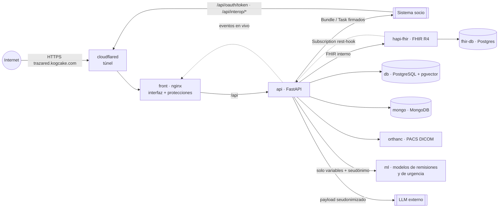
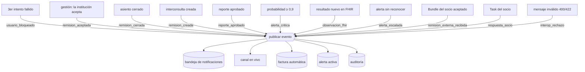
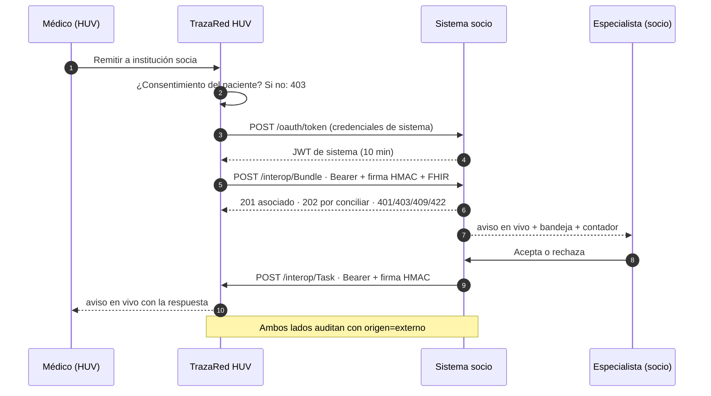

# TrazaRed HUV

**Libro de radicación y trazabilidad de las remisiones de pacientes del Hospital
Universitario del Valle "Evaristo García".**

TrazaRed HUV es el **registro** de cada remisión de un paciente, de principio a fin. Cada
remisión se asienta en un libro con su número de radicado (`REM-2026-000482`) y desde ahí
queda escrito todo su recorrido: a qué instituciones se contactó, qué respondieron, si había
convenio con la EPS, qué tan grave estaba el paciente, cuándo se cerró y cuánto costó la
espera. Nada de lo que se anota se edita ni se borra. Una inteligencia artificial pronostica
sola qué remisiones van a terminar mal, sugiere a qué institución llamar y clasifica cada
respuesta; un asistente clínico responde con las guías y cita sus fuentes; la información
clínica viaja en un estándar interoperable (HL7 FHIR), también hacia otras instituciones, y
los avisos llegan en tiempo real a quien tiene que actuar.

**En línea:** https://trazared.kogcake.com

Proyecto de la asignatura Salud Digital, Universidad Autónoma de Occidente (2026-2).
**Equipo:** Luz Ángela Carabalí Mulato, Laura Daniela Astudillo Ortega, Nicolás Zapata
Obando y David Ortega Quintero.

---

## El problema

El HUV es el hospital público de alta complejidad de referencia del suroccidente
colombiano. Cuando un paciente necesita un servicio que el hospital no tiene disponible,
hay que remitirlo a otra institución con cupo y con convenio con su EPS. Hoy esa gestión
se hace caso a caso, llamada por llamada, sin un registro único: después nadie puede
demostrar qué instituciones fueron contactadas, qué respondieron ni cuánto tiempo pasó.
La Corte Constitucional documentó ese vacío en la Sentencia T-573 de 2023.

TrazaRed HUV convierte esa gestión en un libro con rastro: cada remisión es un asiento,
cada intento de contacto una línea firmada de su bitácora, y cada corrección un asiento
nuevo que remite al original. Nada se borra de verdad.

## Qué hace el sistema

- **Lleva el libro de radicación:** cada remisión con su radicado, folio, fecha y hora,
  quién la asentó, una marca por cada intento de contacto, su pronóstico y su sello de
  cierre. Resalta las que llevan más de 6 horas sin movimiento.
- **Arma el formato oficial de cada remisión (TR-FR-01):** paciente, solicitud y signos
  vitales, bitácora firmada, apoyo de IA, costos, cierre y el recorrido completo del asiento
  (contactos, correcciones con *antes → después*, cambios de estado, pronósticos y facturas).
- **No deja editar la bitácora:** solo se agregan contactos; el estado avanza solo con lo
  que se anota (pendiente → en gestión → aceptada) y el asiento se cierra como trasladado o
  rechazado.
- **Bitácora por voz:** *Dictar llamada* transcribe en el navegador y propone los campos de
  la anotación; la persona revisa y confirma antes de guardar.
- **Cuida la historia clínica:** las ediciones guardan la versión anterior, el "borrado" es
  una anulación lógica y solo el administrador restaura.
- **Recupera información eliminada:** imágenes y remisiones ocultadas se recuperan desde
  *Recuperación de información*, con motivo y auditoría.
- **Pronostica con IA de forma automática** qué tan probable es que cada remisión termine
  efectiva, sugiere a qué institución llamar y clasifica la causa de cada respuesta. También
  estima la urgencia del paciente (modelo KTAS) y deja la decisión al médico.
- **Asistente clínico y agente de remisiones:** responde preguntas con las guías y cita sus
  fuentes; el agente revisa al paciente y **propone** la remisión, que el médico aprueba o
  rechaza. Traza, el asistente flotante, está en todas las pantallas y se le puede hablar.
- **Protege los datos personales:** al modelo de IA nunca le llegan nombre, documento ni
  datos de contacto, y en la base van cifrados.
- **Lleva la contabilidad por radicado:** cada remisión acumula sola sus costos (estancia en
  espera, gestiones y traslado) y se factura a la EPS cuando se cierra, con glosas y pagos.
- **Permite descargar todo:** el libro en Excel, PDF y CSV; cada remisión como constancia
  PDF, bitácora en Excel y Bundle FHIR; el libro contable en Excel, PDF y JSON tipo RIPS.
- **Separa lo que ve cada persona** según su rol; el paciente sigue su remisión como el
  rastreo de un envío.
- **Muestra imágenes médicas reales** (radiografías de tórax) en los anexos de la remisión,
  con un visor de brillo, contraste, negativo y zoom.
- **Habla FHIR:** pacientes, remisiones y observaciones viven también en un servidor HL7
  FHIR R4 con códigos LOINC y SNOMED.
- **Conversa con otras instituciones:** envía y recibe remisiones en FHIR de API a API, con
  credenciales de sistema, firma en cada mensaje y consentimiento del paciente.
- **Reacciona solo:** avisos en vivo, bandeja de notificaciones, flujos automáticos y
  alertas críticas que escalan si nadie las atiende.
- **Deja auditoría** de quién hizo qué, sobre qué y cuándo, incluidas las descargas.

## Arquitectura

Todo el sistema son nueve servicios en Docker que se levantan con un solo comando. Desde
internet solo se entra por un túnel de Cloudflare que llega a nginx, la única puerta: ahí
se aplican las protecciones. Las bases de datos, el servidor de imágenes, el servidor FHIR y
el servicio de IA no se ven desde afuera.



| Servicio | Tecnología | Qué hace |
|---|---|---|
| `front` | nginx | Sirve la interfaz web y es la puerta única hacia la API |
| `cloudflared` | Cloudflare Tunnel | Publica el sistema en internet con HTTPS, sin abrir puertos |
| `api` | Python · FastAPI | Libro de radicación, formatos, descargas, usuarios y roles, IA, asistente y agente, contabilidad, historia, eventos e interoperabilidad |
| `ml` | Python · XGBoost, scikit-learn | Modelos de remisiones (pronóstico, sugerencia, causas) y de urgencia; solo la API le habla |
| `db` | PostgreSQL + pgvector | Pacientes, usuarios, remisiones, observaciones, pronósticos, reportes, alertas, auditoría y vectores del asistente |
| `mongo` | MongoDB | Bitácora de contactos de cada remisión y facturas |
| `orthanc` | Orthanc | Servidor de imágenes médicas (PACS) en formato DICOM |
| `hapi-fhir` y `fhir-db` | HAPI FHIR R4 · PostgreSQL | Servidor de interoperabilidad y su base |

**Por qué dos bases:** PostgreSQL guarda lo estructurado y relacionado (un paciente tiene
remisiones, una remisión tiene observaciones y pronósticos). MongoDB guarda lo que cambia
de forma: los intentos de contacto de cada remisión van como lista dentro de un solo
documento, y las facturas tienen campos distintos según el servicio.

## Roles

No hay registro público: solo el administrador crea cuentas y asigna roles.

| Rol | Al entrar ve | Qué hace |
|---|---|---|
| **Admin** (Oficina de Referencia y Contrarreferencia) | Libro de radicación | Todo lo del médico, más costos en el formato, anular y restaurar asientos, usuarios, auditoría, seguridad, instituciones socias, libro contable y reentrenar la IA |
| **Médico** | Libro de radicación | Radica remisiones, anota gestiones, cierra asientos, anota correcciones, pide análisis de IA, remite al especialista y a la institución socia |
| **Especialista** | Libro de radicación | Consulta formatos y anexos clínicos, acepta sus interconsultas y las remisiones recibidas de otra institución, y revisa reportes de IA |
| **EPS** | Libro con los asientos de sus afiliados | Consulta y descarga, solo lectura |
| **Contable** | Libro contable | Factura radicados cerrados, registra glosas, pagos y anulaciones; nunca ve datos clínicos |
| **Paciente** | Seguimiento de su remisión | Ve en qué va su remisión, en palabras sencillas y sin datos del personal |
| **Dirección** | Tendencias de la red | Ve la población por semana (remisiones, IA, alertas) y la agrupación clínica en `GET /tablero/tendencia`; recibe 403 en fichas e historias individuales |
| **Ingeniería biomédica** | Estado técnico | Administra el PACS y la tecnología: recupera imágenes eliminadas, vigila los servicios (PostgreSQL, MongoDB, PACS, FHIR, IA) y revisa la auditoría técnica. Ve a los pacientes solo con seudónimo |

## Seguridad

- **Bloqueo de cuenta** al tercer intento fallido: no entra ni con la contraseña correcta
  hasta que el administrador la desbloquea, y el administrador recibe el aviso en vivo.
- **Sesión obligatoria** en todas las rutas de datos (token JWT) y control de acceso por
  rol: lo que no le corresponde a un rol, se niega.
- **Contraseñas con Argon2id** (lento y costoso en memoria a propósito). Las que estaban en
  bcrypt se migran solas la primera vez que su dueño inicia sesión.
- **Datos personales cifrados en la base:** documento, teléfono, dirección y correo del
  paciente se guardan con AES-256-GCM; la llave vive en el `.env`. Se busca por documento con
  un índice ciego, sin descifrar.
- **Auditoría encadenada:** cada registro guarda la huella del anterior; el administrador
  puede verificar en cualquier momento si alguien editó o borró un registro
  (`GET /auditoria/verificar`).
- **Guardia del asistente:** un texto que intenta darle órdenes al asistente no llega al
  modelo, queda registrado con usuario e IP y, si se insiste, bloquea la cuenta 15 minutos.
- **Entradas externas autenticadas:** el webhook de FHIR exige `X-Webhook-Secret`; el
  sistema socio entra con token de sistema y firma HMAC en cada mensaje.
- **Modelo de amenazas STRIDE:** cada control responde a una amenaza, con su evidencia y su
  riesgo residual, en [`docs/STRIDE.md`](docs/STRIDE.md).
- **Bitácora inalterable:** la API rechaza (409) cualquier intento de modificar o quitar un
  contacto ya anotado; cada gestión queda firmada con usuario y hora.
- **Protecciones web:** CORS cerrado al dominio propio, cabeceras de seguridad y límite de
  peticiones por visitante.
- **Ningún secreto en el repositorio:** solo se publica `.env.example`; las claves reales
  se comparten por un canal privado.
- **Superficie mínima:** bases, PACS, FHIR y API solo escuchan dentro del equipo; el
  servicio de IA no se publica.
- **Datos hacia la IA seudonimizados:** antes de llamar a cualquier modelo se quitan nombre,
  documento, correo, teléfono y dirección; viajan solo las variables clínicas y
  administrativas y un código que no permite volver al paciente.
- **Auditoría** de inicios de sesión fallidos, bloqueos, creación de usuarios y pacientes,
  radicaciones, gestiones anotadas, cambios de estado, cierres, correcciones, anulaciones y
  restauraciones, pronósticos, análisis y aprobaciones de IA, lo enviado al LLM, facturas,
  glosas, pagos, descargas, alertas, eventos FHIR e intercambios con instituciones socias.

En la pantalla *Seguridad* (admin) se ven el cifrado, la cadena de auditoría, las
contraseñas, los incidentes, los bloqueos, los límites y todo lo que se le envió al LLM.

## Datos

| Conjunto | Origen | Para qué |
|---|---|---|
| **600 remisiones** | Sintéticas, generadas con semilla fija | Poblar el libro con casos en tres grupos según cómo terminó la remisión (efectiva, fallida y borderline o abierta) y entrenar el modelo de remisiones |
| **2 080 contactos de la bitácora** | Sintéticos, generados con las remisiones | Entrenar el pronóstico durante la gestión, el sugeridor de instituciones y el clasificador de respuestas |
| **600 radiografías de tórax** | Reales, NIH ChestX-ray14 (Wang et al., 2017) | Una por paciente, en el PACS; las remisiones fallidas tienen radiografía con hallazgo y las efectivas, sin hallazgo |
| **1 267 pacientes de urgencias** | Reales, dataset KTAS (Moon et al., PLOS ONE 2019, CC BY 4.0) | Entrenar y evaluar el modelo de urgencia |
| **190 pacientes sintéticos** | Generados dentro de 4 perfiles de pacientes reales | Poblar el sistema sin exponer pacientes reales; marcados como sintéticos y nunca usados para entrenar |
| **Corpus del asistente** | 19 guías y normas redactadas por el equipo a partir de fuentes públicas | Base documental del asistente clínico, que cita sus fuentes |

Fuentes, licencias y el detalle de cada conjunto: [`docs/DATASETS.md`](docs/DATASETS.md) y
[`docs/README.md`](docs/README.md).

## Inteligencia artificial

**Modelo de remisiones (el del libro).** Responde preguntas sobre la remisión, no sobre el
paciente (`ml/remisiones_modelo.py`):

- **Probabilidad de que termine efectiva**, con dos modelos XGBoost: uno *al radicar*, solo
  con lo que se sabe en ese momento (edad, sexo, EPS, sentido, convenio, gravedad del
  motivo y signos vitales), y otro *durante la gestión*, que suma lo que va dejando la
  bitácora contado hasta ese instante (contactos, rechazos, sin respuesta, instituciones
  distintas y horas de gestión).
- **Institución sugerida:** tasa histórica de aceptación por institución, EPS y tipo de
  motivo, suavizada para no premiar a una institución con un solo caso.
- **Causa de cada respuesta** (sin cama, sin especialista, convenio o autorización de la
  EPS, sin respuesta, pide documentos, en evaluación, acepta): TF-IDF con regresión
  logística, con reglas de respaldo cuando duda.
- **Tiempo estimado hasta aceptación** según remisiones efectivas parecidas.

Para evitar la fuga de información, el estado de la remisión nunca entra al modelo, el
número de contactos y las horas de gestión solo entran contados hasta el momento del
pronóstico, y la validación del modelo de gestión es agrupada por remisión. Las remisiones
abiertas no se usan para entrenar: son las que se pronostican. **Limitación:** con el
dataset sintético el AUC sale cercano a 1,00 porque los grupos se generaron con reglas muy
marcadas; con datos reales del HUV las métricas serían menores.

**La IA trabaja sola.** Al arrancar la API, y luego cada 30 minutos, pronostica todas las
remisiones abiertas; además recalcula cada vez que se anota una gestión o se abre un
formato. Cada pronóstico queda escrito en el recorrido del asiento y, al cerrarlo, se anota
si la IA acertó.

**Perfiles de pacientes.** Con K-means se encontraron cuatro perfiles en los pacientes de
urgencias: hipoxemia severa, presión arterial alta, sin dolor y jóvenes con dolor. Se
compararon cuatro algoritmos de agrupamiento y se identificaron las zonas donde el modelo
más se confunde. Al predecir, `POST /ia/asignar` muestra el perfil del paciente, su
pertenencia suave (GMM con los parámetros del K-means) y si es atípico (Isolation Forest).

**Modelo de urgencia.** Se compararon 11 modelos con el mismo preprocesamiento y la misma
validación cruzada; ganó **XGBoost**. Para cada paciente entrega una probabilidad de ser
urgente:

- Desde **0,4** lo considera urgente: en 254 pacientes que nunca vio detectó 130 de 147
  urgentes (sensibilidad 88 %, especificidad 51 %, precisión 71 %, F1 0,79).
- Desde **0,9** enciende una **alerta crítica**: en la prueba saltó en 31 pacientes y 28
  eran urgentes.
- **Sesgo conocido:** casi todos los urgentes que se le escapan son menores de 65 años.

**La IA sugiere, el equipo decide.** Los pronósticos de remisiones son orientativos y así se
muestran. Cada análisis de urgencia, y todo lo que proponen el asistente y el agente, crea
un reporte o borrador pendiente que solo el médico o el especialista aprueba o rechaza; lo
aprobado entra a la historia clínica y lo rechazado se conserva como evidencia.

El entrenamiento del modelo de urgencia está en `notebooks/semana9_final.ipynb`. Los dos
modelos se pueden reentrenar desde la API.

**Asistente clínico con fuentes (RAG).** Búsqueda híbrida (BM25 + densa con RRF),
multiconsulta y MMR; historia aprobada leída de la base y filtrada antes de rankear;
abstención calibrada; pgvector en el contenedor `db`. Cada respuesta cita el documento y el
fragmento usados y, si no encuentra soporte, lo dice en vez de inventar. Las fuentes están
declaradas en [`docs/DATASETS.md`](docs/DATASETS.md), sección *Corpus*, y la evaluación con
26 preguntas, en `docs/RAG_evaluacion.md`. Detalle en `docs/RAG.md`.

**Agente clínico de remisiones.** `python/agente/`: un agente con harness (prompt por capas,
7 herramientas, 2 skills, auditoría, semáforo, tiempo máximo, memoria en PostgreSQL) que
revisa al paciente abierto, estima su urgencia, busca en las guías y en las instituciones
con convenio con su EPS, y **propone** la remisión. El médico la aprueba o la rechaza desde
la tarjeta de aprobación. Endpoints `POST /agente/chat` y `POST /agente/decidir`. Sin
`GROQ_API_KEY` funciona con un modelo simulado. Cada herramienta respeta el rol de quien
pregunta (el contable recibe 403) y cada payload enviado al LLM queda guardado para
comprobar que no lleva datos personales. Detalle en `docs/AGENTE.md`.

**En la interfaz:** *Asistente clínico* (agente y consulta a guías), *Reportes de IA*
(aprobar o rechazar reportes pendientes, también desde la pantalla de predicción) y
*Tendencias de la red* (admin y director).

### Traza: asistente flotante con voz

Botón con carita en la esquina inferior derecha de todas las pantallas
(`frontend/js/burbuja.js`). Se le escribe o se le habla (micrófono: Chrome o Edge), como a un
colega, y **responde corto o te lleva al lugar**:

| Le dices | Hace |
|---|---|
| «¿Cómo va Marleny Balanta?» · «busca la cédula 1175373460» | Abre su ficha y resume lo que importa: diagnóstico, estado, signos alterados, alergias y último contacto |
| «¿Qué tengo pendiente?» · «alertas» · «remisiones en riesgo» · «las de hoy» | Cuenta y lista; un toque te lleva |
| «¿Qué tan grave está?» · «¿a dónde lo remito?» | Pregunta al agente clínico con el paciente en contexto |
| «Criterios de qSOFA» | Responde con las guías y muestra sus fuentes |
| «Radicar remisión» · «nuevo paciente» · «dictar llamada» | Te lleva y abre el formulario |
| «Llévame a instituciones» · «abre la remisión 45» | Navega |
| (admin) «usuarios bloqueados» · «estado del sistema» · «¿la auditoría está íntegra?» · «incidentes» | Responde sobre el sistema por dentro |

**Al médico** le llega la respuesta y sus fuentes, no el proceso. **Al administrador**, además,
el detalle técnico: qué herramientas se usaron, con qué argumentos y qué se envió al LLM.
Cuando abres una ficha, Traza ya sabe de qué paciente hablas y sugiere la siguiente pregunta.

Búsqueda, navegación, conteos y resúmenes se resuelven en el navegador con la API del
sistema: nombres y documentos no van a ningún modelo de lenguaje. Respeta el rol de cada usuario.

## Flujo clínico

1. El médico **radica la remisión** en el libro: queda con su número de radicado, la hora y
   su firma, y la IA hace el primer pronóstico.
2. La Oficina de Referencia **anota cada intento de contacto** en la bitácora (escrito o
   dictado). La IA le pone la causa a la respuesta, recalcula el pronóstico y sugiere la
   siguiente institución; si la institución acepta, el asiento pasa solo a *Aceptada*.
3. Si la institución destino está conectada, el médico puede **remitir a la institución
   socia** desde el formato: con el consentimiento del paciente, la remisión viaja en FHIR y
   la respuesta vuelve sola.
4. Cuando el paciente es trasladado (o no se logra), se **cierra el asiento**: queda la
   institución que aceptó, la hora de cierre y si la IA acertó, y el contable recibe el
   aviso de que está listo para facturar.
5. El contable **factura a la EPS** lo que acumuló la remisión y registra glosas y pagos.
6. En paralelo, el médico puede pedir el **análisis de urgencia** del paciente, aprobarlo o
   rechazarlo, consultar al **asistente clínico** y **remitir al especialista**
   (interconsulta), que la ve en su bandeja.
7. La **constancia en PDF**, la bitácora en Excel y el **Bundle FHIR** de la remisión se
   descargan desde el formato; la historia clínica en PDF, desde los anexos.
8. Cuando llega un resultado nuevo al servidor FHIR (por ejemplo, una glucosa de
   laboratorio), el médico responsable recibe el aviso.

## Sistema reactivo

La información llega sola a quien la necesita, sin recargar la página:

- **Canal en vivo** que respeta los roles: el paciente y el contable no reciben eventos
  clínicos.
- **Bandeja de notificaciones** y contadores de pendientes (reportes por revisar,
  remisiones recibidas, alertas activas).
- **Flujos automáticos:** la primera gestión pone el asiento en gestión, un "acepta" lo pone
  en aceptada y avisa al médico que radicó, el cierre avisa al contable, remitir avisa al
  especialista, aprobar un reporte crea la factura del análisis y un bloqueo avisa al
  administrador.
- **Eventos externos:** una remisión recibida de otra institución avisa a los especialistas,
  la respuesta del socio avisa al médico que la envió y un mensaje rechazado por validación
  avisa al administrador.
- **Pronósticos automáticos** de todas las remisiones abiertas al arrancar y cada 30 minutos.
- **Alertas críticas** que se quedan en pantalla hasta que un médico las reconoce; si nadie
  lo hace en 10 minutos, se escalan al administrador.

El catálogo de eventos está en [`docs/EVENTOS.md`](docs/EVENTOS.md).

**FHIR reactivo (R21) por la puerta autenticada.** HAPI no se publica en internet (no tiene
autenticación propia y guarda nombre y documento; STRIDE T6 e I6). Desde afuera se habla FHIR
con la API, con JWT y rol clínico: `GET /api/fhir/Patient?identifier=urn:trazared:documento|<doc>`
devuelve el `Patient` sincronizado **sin nombre ni contacto**, y `POST /api/fhir/Observation`
(admin o médico) escribe en HAPI una Observation de glucosa (LOINC 2339-0). La Subscription de
HAPI avisa a `/fhir/observacion` con `X-Webhook-Secret` y el médico recibe el aviso en vivo; si
el valor es crítico, la alerta queda activa (R20). Las dos rutas exigen que el paciente esté a
cargo de quien pregunta y dejan auditoría.



## Interoperabilidad

| Dato en TrazaRed | Recurso HL7 FHIR R4 | Codificación |
|---|---|---|
| Paciente | `Patient` | Documento como identificador (identificador federado hacia otras instituciones) |
| Remisión entre instituciones | `Encounter` y, en el Bundle descargable, `ServiceRequest` | Radicado como identificador, origen, destino y estado |
| Intento de contacto de la bitácora | `Communication` (en el Bundle descargable) | Institución, medio, respuesta y causa |
| Signo vital u observación | `Observation` | LOINC y unidades UCUM |
| Remisión de médico a especialista | `ServiceRequest` | SNOMED CT (306206005, remisión a servicio) |
| Análisis de IA aprobado | `DiagnosticReport` | Solo viaja si un clínico lo aprobó |
| Consentimiento del paciente | `Consent` | Por institución destino |
| Respuesta de la institución socia | `Task` | Aceptada o rechazada |

HAPI intercambia recursos con la API en la red Docker. Desde el navegador, la descarga FHIR
autorizada está en el detalle del asiento. El puerto local de HAPI está reservado para
diagnóstico en el equipo que ejecuta Docker.

Al arrancar, la API crea una suscripción en el servidor FHIR para enterarse cuando llega
una observación nueva. Cada remisión se puede descargar como un `Bundle` FHIR R4 completo
desde su formato. El mapeo campo por campo está en
[`documentacion_mapeo_roles.md`](documentacion_mapeo_roles.md).

### Intercambio con la institución socia

Cada equipo es una institución. El médico de una remite un paciente al especialista de la
otra; la información viaja en FHIR, de API a API, de forma segura.



- **El socio entra como sistema:** OAuth2 *client credentials* por institución; ese token
  solo abre `/interop/*` y la API clínica le responde 403.
- **Cada mensaje va firmado** con HMAC; alterado o sin firma se rechaza con 401 y repetido,
  con 409.
- **Se valida antes de guardar:** un recurso inválido se rechaza con 422 y un
  `OperationOutcome`, sin dejar nada a medias.
- **Consentimiento y minimización:** sin consentimiento del paciente para esa institución
  no sale nada; el Bundle no lleva documento ni teléfono (identificador federado).
- Las parejas se asignan al azar, así que se pueden registrar varias instituciones socias.

**Pantallas.** *Interoperabilidad* (médico, especialista, admin): remisiones recibidas y
enviadas; el admin además registra las instituciones socias, prueba la conexión, rota
credenciales y ve la bitácora de mensajes. El contrato completo está en
[`docs/INTEROP.md`](docs/INTEROP.md).

## Marco normativo

Alcance y fuentes revisadas el 17/11/2026: [NORMATIVA.md](docs/NORMATIVA.md). Incluye la revocatoria de la Res. 1732/2026 por la 2080/2026. La historia FHIR es un documento académico preliminar; el JSON contable es de demostración. Ninguno acredita validación nacional RDA o FEV-RIPS.


| Norma | Alcance | Controles técnicos del prototipo |
|---|---|---|
| Ley 1581 de 2012 (protección de datos) | Finalidad, circulación restringida y seguridad de los datos personales | Seudonimización hacia la IA, cifrado de campos, acceso por rol, contable sin datos clínicos, consentimiento por institución socia, auditoría |
| Ley 2015 de 2020 (historia clínica electrónica interoperable) | Historia clínica que se pueda intercambiar entre prestadores | Servidor FHIR R4 con LOINC y SNOMED, Bundle FHIR por remisión, intercambio con instituciones socias, historia clínica en PDF |
| Resolución 866 de 2021 y 1888 de 2025 | Datos clínicos relevantes y RDA nacional | Recursos FHIR y documento académico con Composition; pendiente validación y adecuación al perfil nacional |
| Resolución 1995 de 1999 (historia clínica) | Confidencialidad, integridad y custodia; los registros no se destruyen | Bitácora inalterable, auditoría encadenada, anulación lógica con restauración, historial de correcciones, reportes rechazados conservados |
| Ley 1273 de 2009 (delitos informáticos) | Protege contra el acceso abusivo y la violación de datos personales (arts. 269A y 269F) | Bloqueo de cuenta, límite de intentos, incidentes con usuario e IP, bloqueo temporal |
| Resolución 3100 de 2019 y modificaciones (habilitación) | Régimen institucional aplicable; la 1732/2026 fue revocada por 2080/2026 | Trazabilidad del libro; no acredita habilitación del prestador |

## Requisitos y dónde se cumplen

| Requisito | Qué hace TrazaRed | Dónde |
|---|---|---|
| **R23** Agente RAG con fuentes | Cada respuesta cita documento y fragmento; sin soporte, lo dice | `python/rag/`, `docs/DATASETS.md` § Corpus |
| **R24** Herramientas por rol | El paciente lo fija el sistema, cada herramienta revisa el rol y **cada payload enviado al LLM queda guardado** para comprobar que no lleva datos personales | `python/agente/`, Seguridad › *Lo enviado al LLM* |
| **R25** Prompt injection | Detector + datos delimitados + política fuera del modelo + aprobación humana; incidente con usuario e IP y bloqueo temporal | `python/seguridad.py` |
| **R26** Modelo STRIDE | Diagrama de flujo de datos con fronteras de confianza y 32 amenazas con control, evidencia, riesgo residual y norma | [`docs/STRIDE.md`](docs/STRIDE.md) |
| **R27** Cifrado de campos | AES-256-GCM de documento, teléfono, dirección y correo, atado a cada paciente; índice ciego para buscar | `python/cripto.py` |
| **R28** Auditoría encadenada | Huella HMAC encadenada y `GET /auditoria/verificar` (solo admin) | `python/auth.py` |
| **R29** Entradas autenticadas | Webhook FHIR con `X-Webhook-Secret`; sistema socio con token y firma en cada mensaje | `python/seguridad.py`, `python/interop.py` |
| **R30** Remisiones FHIR | Envía y recibe `Bundle` (Patient, ServiceRequest, Observation, DiagnosticReport aprobado, Consent) y responde con `Task`; lo inválido se rechaza con `OperationOutcome` sin dejar nada a medias | `python/interop.py` |
| **R31** Autenticación entre sistemas | OAuth2 *client credentials* por institución; ese token solo abre `/interop/*` | `POST /oauth/token` |
| **R32** Consentimiento y minimización | Sin consentimiento del paciente para esa institución no sale nada; el Bundle no lleva documento ni teléfono (identificador federado) | Formato › *Remitir a institución socia* |
| **R33** Demostración cruzada | Ida y vuelta entre las dos URL públicas, sin recargar, con la auditoría de ambos lados | [`docs/INTEROP.md`](docs/INTEROP.md) § 9 |

## Estructura del repositorio

```
TrazaRedHUV/
├── .env.example              # Plantilla de variables (las claves reales nunca se suben)
├── tester.yaml               # Datos para la verificación automática del sistema
├── db/                       # Esquema de PostgreSQL (se aplica solo al arrancar)
├── docker-compose.yml        # Los 9 servicios: un solo `docker compose up -d` desde la raíz
├── docker/                   # nginx.conf (y un compose que solo incluye el de la raíz)
├── python/                   # API: registro (libro, formato, descargas), libro, exportes,
│                             # causas, auth, seguridad, cripto, remisiones, ia, historia,
│                             # contabilidad, eventos, fhir_sync, interop, pacs,
│                             # agente/ (agente clínico), rag/ (asistente con fuentes)
│                             # y scripts de carga de datos
├── ml/                       # Servicio de IA: modelo de remisiones, modelo de urgencia,
│                             # perfiles y entrenamiento
├── frontend/                 # Interfaz web de una sola página (HTML, CSS, JS);
│                             # registro.js y registro.css son el libro y el formato
├── data/                     # Dataset de las 600 remisiones (CSV)
├── docs/                     # STRIDE, interoperabilidad, eventos, datasets, RAG, agente,
│                             # contabilidad, normativa, respaldo y documentos del proyecto
├── notebooks/                # Cuadernos: proyecto, dataset, modelos, RAG y agente
├── pruebas/                  # Pruebas automáticas del sistema
├── scripts/                  # Verificación del tester, pruebas de integración y respaldo
├── evidencia_endpoints/      # Capturas de funcionamiento
├── levantar_demo.py          # Demo ligera sin Docker (bases en la nube)
└── documentacion_mapeo_roles.md  # Mapeo a FHIR, justificación de roles y mapa de leyes
```

## Cómo ejecutarlo

Requisitos: Docker Desktop abierto y con el motor corriendo (con Docker Compose 2.24 o más
nuevo) y Python 3.10+ para las pruebas y los cuadernos.

**1. Configurar las variables.** En la raíz del proyecto copia la plantilla y llénala con
las claves que comparte el equipo por el canal privado:

```powershell
copy .env.example pass.env
```

`pass.env` (o `.env`) nunca se sube al repositorio. Docker lo lee al **crear** el
contenedor: si lo agregas o lo cambias después, recrea la API con
`docker compose --env-file pass.env up -d --force-recreate api`. Variables opcionales: `TUNNEL_TOKEN` para el
dominio fijo, `ESCALAMIENTO_SEGUNDOS` (600 por defecto), `VALOR_ANALISIS_IA` (80 000 COP por
defecto), `PRONOSTICO_CADA_MIN` (cada cuánto la IA vuelve a pronosticar, 30 por defecto;
0 lo apaga) y las tarifas de referencia de la contabilidad (`TARIFA_ESTANCIA_URGENCIAS_HORA`,
`TARIFA_ESTANCIA_UCI_HORA`, `TARIFA_GESTION_CONTACTO`, `TARIFA_TRASLADO_BASICO`,
`TARIFA_TRASLADO_MEDICALIZADO`).

Para el asistente y el agente: `GROQ_API_KEY`, `MODELO_GROQ`, `LLAVE_SEUDONIMO`,
`AGENTE_TIMEOUT_S`, `AGENTE_MAX_SIMULTANEAS` y `DEMO_DIRECTOR_PASSWORD` (usuario
`director@huv.gov.co`). Para la seguridad y la interoperabilidad: `LLAVE_CIFRADO`,
`LLAVE_INDICE`, `LLAVE_AUDITORIA`, `FHIR_WEBHOOK_SECRET`, `SECRETO_FEDERADO` (igual en las
dos instituciones socias) e `INSTITUCION_NOMBRE`. Si no se definen, las llaves se derivan de
`SECRET_KEY`. Todas son opcionales; ver [`.env.example`](.env.example).

Para una configuración local, genera valores hexadecimales aleatorios e independientes para
las cuatro variables `TRAZARED_*_PASSWORD` de la plantilla. Si ya existen los volúmenes de
PostgreSQL, configura inicialmente las claves vigentes de ambos motores. Las variables de
inicialización de PostgreSQL y MongoDB se aplican a volúmenes vacíos. Para migrar un Mongo
existente, respáldalo con la configuración anterior y restáuralo en un volumen nuevo, ya
inicializado con autenticación. Conserva el volumen anterior hasta verificar el respaldo.
El script de respaldo lee `pass.env` por defecto y acepta `TRAZARED_COMPOSE_ENV` para otro archivo.

**2. Levantar el sistema** (desde la raíz del repositorio, con un solo comando):

```powershell
docker compose --env-file pass.env up -d --build
docker compose --env-file pass.env ps
```

Si el archivo de variables se llama `.env`, Compose lo lee solo y basta `docker compose up -d`.
El proyecto conserva el nombre `docker` (antes el compose vivía en `docker/`), así que usa los
mismos volúmenes y no se pierde ningún dato. `cd docker && docker compose up -d` sigue funcionando.

Al arrancar, la API crea las tablas, un usuario de prueba por rol y la suscripción FHIR, y
la IA empieza a pronosticar las remisiones abiertas. La primera vez, el servicio `ml`
entrena el modelo de remisiones (unos segundos). Para confirmarlo:

```powershell
docker compose logs api | findstr "[IA]"
```

**3. Cargar los datos** (solo la primera vez):

```powershell
docker compose exec api python cargar_dataset.py
docker compose run --rm -v RUTA\datos_imagenes:/datos_imagenes:ro api python sembrar_imagenes_reales.py --max 600
```

`RUTA\datos_imagenes` es la carpeta donde descargaste las imágenes del NIH (`images_001`) y
`Data_Entry_2017_v2020.csv`. Después de cargar el dataset, `docker compose restart api` hace
que la IA pronostique esas remisiones de inmediato.

**4. Publicarlo en internet.** Con `TUNNEL_TOKEN` en el archivo de variables:

```powershell
docker compose --profile tunel-fijo up -d
docker compose stop cloudflared
```

Sin token, `docker compose logs cloudflared` muestra una URL temporal de `trycloudflare.com`.
La interfaz HTTP local escucha en loopback; para acceso remoto, usa el túnel HTTPS.

**5. Verificar:**

```powershell
pip install -r requirements.txt
python pruebas\probar_registro.py      # libro, formato, IA automática, contabilidad y descargas
python pruebas\probar_persona1.py      # acceso, seguridad, Docker, túnel y auditoría
python pruebas\probar_persona2.py      # IA de urgencia, perfiles, seudonimización, reportes y facturas
python pruebas\probar_persona4.py      # canal en vivo, notificaciones y alertas
python pruebas\probar_agente.py        # asistente clínico y agente
```

`probar_registro.py` hace 40 verificaciones con los seis roles y debe terminar en
`FALLAS: ninguna`. Escribe en la base (anota gestiones, cierra y factura una remisión), así
que se corre sobre los datos de prueba; los archivos que descarga quedan en
`pruebas/descargas/`.

Seguridad e interoperabilidad (48 comprobaciones; usa un socio de prueba que es este mismo
sistema):

```bash
docker compose up -d --build api
docker compose exec api python /app/pruebas/probar_final.py
```

En tu equipo, la interfaz queda en **http://localhost:8080** y la documentación de la API en
http://localhost:8000/docs.

**6. Contrato del tester.** `tester.yaml` usa referencias de entorno para los secretos. Si el
tester del docente requiere un YAML con valores ya resueltos, carga las variables en el
entorno y ejecuta `python scripts/preparar_tester.py RUTA_PRIVADA.yml`. El archivo se crea
con acceso solo para el dueño y se entrega por el canal privado.

Para comprobar el contrato sobre un despliegue HTTPS de demostración, usa un entorno
con `requests`, `python-dotenv` y `PyYAML` e indica el archivo privado de variables.
La prueba crea registros sintéticos, cambia su estado y llama a las rutas de reentrenamiento.

```sh
python scripts/verificar_tester.py --env-file RUTA_PRIVADA.env \
  --entorno-de-prueba --salida resultado-tester.json
```

La URL predeterminada sale de `tester.yaml`. El reporte JSON guarda el resultado y el
código HTTP de cada caso por requisito, sin copiar cuerpos de respuesta ni credenciales.
Los casos pendientes requieren revisar sus dependencias o completar una prueba manual.

La comprobación pública de lectura la hace `scripts/verificar_entrega_publica.py` y las
pruebas API/Chromium con bases desechables, `scripts/probar_integracion.sh`. La evidencia de
la corrida del 17 de noviembre queda en
[docs/evidencia/2026-11-17-sustentacion.json](docs/evidencia/2026-11-17-sustentacion.json).
`tester.yaml` declara también los escenarios completos de fechas imposibles, gestiones
huérfanas y conciliación FHIR de `202` a ficha asociada. La remisión de ida y vuelta con el
equipo socio (R33) se demuestra en vivo en la sustentación.

## Usuarios de demostración

Todos los datos de pacientes son sintéticos o de datasets públicos.

| Rol | Usuario | Contraseña |
|---|---|---|
| Admin | `admin@trazared.huv` | `DEMO_ADMIN_PASSWORD` |
| Médico | `medico@huv.gov.co` | `DEMO_MEDICO_PASSWORD` |
| Especialista | `especialista@huv.gov.co` | `DEMO_ESPECIALISTA_PASSWORD` |
| Contable | `contable@huv.gov.co` | `DEMO_CONTABLE_PASSWORD` |
| Paciente | `paciente@correo.com` | `DEMO_PACIENTE_PASSWORD` |
| EPS (Coosalud) | `eps@coosalud.com` | `DEMO_EPS_PASSWORD` |
| Dirección | `director@huv.gov.co` | `DEMO_DIRECTOR_PASSWORD` |
| Ingeniería biomédica | `biomedico@huv.gov.co` | `DEMO_BIOMEDICO_PASSWORD` |

Las contraseñas son las de las variables indicadas en el archivo de variables; no están en
el repositorio.

## Documentación

- [`docs/STRIDE.md`](docs/STRIDE.md): modelo de amenazas, fronteras de confianza, controles,
  riesgo residual y mapa normativo (R26).
- [`docs/INTEROP.md`](docs/INTEROP.md): contrato con la institución socia: token, firma,
  perfil FHIR, códigos de respuesta, consentimiento y demostración cruzada (R30–R33).
- [`docs/REDISENO_REGISTRO.md`](docs/REDISENO_REGISTRO.md): libro de radicación, formato,
  descargas, IA de remisiones, contabilidad por radicado y cómo probarlo.
- [`docs/AGENTE.md`](docs/AGENTE.md): agente clínico, herramientas, skills, memoria y límites.
- [`docs/RAG.md`](docs/RAG.md) y [`docs/RAG_evaluacion.md`](docs/RAG_evaluacion.md): asistente
  con fuentes y evaluación de la recuperación.
- [`docs/DATASETS.md`](docs/DATASETS.md): datos, corpus, perfiles, modelo de urgencia,
  umbrales, sesgo y limitaciones.
- [`docs/EVENTOS.md`](docs/EVENTOS.md): eventos, flujos automáticos y alertas.
- [`docs/CONTABILIDAD.md`](docs/CONTABILIDAD.md): estructura de las facturas.
- [`docs/NORMATIVA.md`](docs/NORMATIVA.md): normativa colombiana y alcance del prototipo.
- [`docs/RESPALDO.md`](docs/RESPALDO.md): respaldo y restauración de las bases.
- [`docs/README.md`](docs/README.md): dataset de las 600 remisiones.
- [`documentacion_mapeo_roles.md`](documentacion_mapeo_roles.md): mapeo a FHIR, roles y mapa
  de requisitos a leyes (R01–R33).
- `docs/TrazaRed_HUV.pdf`: documento del proyecto.
