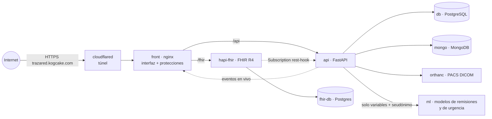
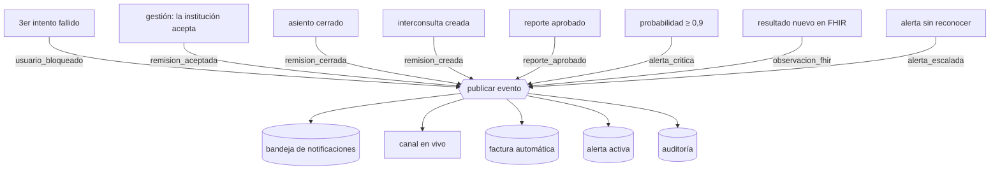

# TrazaRed HUV

**Libro de radicación y trazabilidad de las remisiones de pacientes del Hospital
Universitario del Valle "Evaristo García".**

TrazaRed HUV es el **registro** de cada remisión de un paciente, de principio a fin. Cada
remisión se asienta en un libro con su número de radicado (`REM-2026-000482`) y desde ahí
queda escrito todo su recorrido: a qué instituciones se contactó, qué respondieron, si había
convenio con la EPS, qué tan grave estaba el paciente, cuándo se cerró y cuánto costó la
espera. Nada de lo que se anota se edita ni se borra. Una inteligencia artificial pronostica
sola qué remisiones van a terminar mal, sugiere a qué institución llamar y clasifica cada
respuesta; la información clínica viaja en un estándar interoperable (HL7 FHIR) y los avisos
llegan en tiempo real a quien tiene que actuar.

**En línea:** https://trazared.kogcake.com

Proyecto de la asignatura Salud Digital, Universidad Autónoma de Occidente (2026-2).
**Equipo:** Luz Ángela Carabalí Mulato, Laura Daniela Astudillo Ortega, Nicolás Zapata
Obando y David Ortega Quintero.

---

## El problema

El HUV es el hospital público de alta complejidad de referencia del suroccidente
colombiano. Cuando un paciente necesita un servicio que el hospital no tiene disponible,
hay que remitirlo a otra institución con cupo y con convenio con su EPS. Hoy esa gestión
se hace caso a caso, llamada por llamada, sin un registro único: después nadie puede
demostrar qué instituciones fueron contactadas, qué respondieron ni cuánto tiempo pasó.
La Corte Constitucional documentó ese vacío en la Sentencia T-573 de 2023.

TrazaRed HUV convierte esa gestión en un libro con rastro: cada remisión es un asiento,
cada intento de contacto una línea firmada de su bitácora, y cada corrección un asiento
nuevo que remite al original. Nada se borra de verdad.

## Qué hace el sistema

- **Lleva el libro de radicación:** cada remisión con su radicado, folio, fecha y hora,
  quién la asentó, una marca por cada intento de contacto, su pronóstico y su sello de
  cierre. Resalta las que llevan más de 6 horas sin movimiento.
- **Arma el formato oficial de cada remisión (TR-FR-01):** paciente, solicitud y signos
  vitales, bitácora firmada, apoyo de IA, costos, cierre y el recorrido completo del asiento
  (contactos, correcciones con *antes → después*, cambios de estado, pronósticos y facturas).
- **No deja editar la bitácora:** solo se agregan contactos; el estado avanza solo con lo
  que se anota (pendiente → en gestión → aceptada) y el asiento se cierra como trasladado o
  rechazado.
- **Cuida la historia clínica:** las ediciones guardan la versión anterior, el "borrado" es
  una anulación lógica y solo el administrador restaura.
- **Pronostica con IA de forma automática** qué tan probable es que cada remisión termine
  efectiva, sugiere a qué institución llamar y clasifica la causa de cada respuesta. También
  estima la urgencia del paciente (modelo KTAS) y deja la decisión al médico.
- **Protege los datos personales:** al modelo de IA nunca le llegan nombre, documento ni
  datos de contacto.
- **Lleva la contabilidad por radicado:** cada remisión acumula sola sus costos (estancia en
  espera, gestiones y traslado) y se factura a la EPS cuando se cierra, con glosas y pagos.
- **Permite descargar todo:** el libro en Excel, PDF y CSV; cada remisión como constancia
  PDF, bitácora en Excel y Bundle FHIR; el libro contable en Excel, PDF y JSON tipo RIPS.
- **Separa lo que ve cada persona** según su rol; el paciente sigue su remisión como el
  rastreo de un envío.
- **Muestra imágenes médicas reales** (radiografías de tórax) en los anexos de la remisión,
  con un visor de brillo, contraste, negativo y zoom.
- **Habla FHIR:** pacientes, remisiones y observaciones viven también en un servidor HL7
  FHIR R4 con códigos LOINC y SNOMED.
- **Reacciona solo:** avisos en vivo, bandeja de notificaciones, flujos automáticos y
  alertas críticas que escalan si nadie las atiende.
- **Deja auditoría** de quién hizo qué, sobre qué y cuándo, incluidas las descargas.

## Arquitectura

Todo el sistema son nueve servicios en Docker que se levantan con un solo comando. Desde
internet solo se entra por un túnel de Cloudflare que llega a nginx, la única puerta: ahí
se aplican las protecciones. Las bases de datos, el servidor de imágenes y el servicio de
IA no se ven desde afuera.



| Servicio | Tecnología | Qué hace |
|---|---|---|
| `front` | nginx | Sirve la interfaz web y es la puerta única hacia la API y FHIR |
| `cloudflared` | Cloudflare Tunnel | Publica el sistema en internet con HTTPS, sin abrir puertos |
| `api` | Python · FastAPI | Libro de radicación, formatos, descargas, usuarios y roles, IA, contabilidad, historia, eventos |
| `ml` | Python · XGBoost, scikit-learn | Modelos de remisiones (pronóstico, sugerencia, causas) y de urgencia; solo la API le habla |
| `db` | PostgreSQL | Pacientes, usuarios, remisiones, observaciones, pronósticos, reportes, alertas, auditoría |
| `mongo` | MongoDB | Bitácora de contactos de cada remisión y facturas |
| `orthanc` | Orthanc | Servidor de imágenes médicas (PACS) en formato DICOM |
| `hapi-fhir` y `fhir-db` | HAPI FHIR R4 · PostgreSQL | Servidor de interoperabilidad y su base |

**Por qué dos bases:** PostgreSQL guarda lo estructurado y relacionado (un paciente tiene
remisiones, una remisión tiene observaciones y pronósticos). MongoDB guarda lo que cambia
de forma: los intentos de contacto de cada remisión van como lista dentro de un solo
documento, y las facturas tienen campos distintos según el servicio.

## Roles

No hay registro público: solo el administrador crea cuentas y asigna roles.

| Rol | Al entrar ve | Qué hace |
|---|---|---|
| **Admin** (Oficina de Referencia y Contrarreferencia) | Libro de radicación | Todo lo del médico, más costos en el formato, anular y restaurar asientos, usuarios, auditoría, libro contable y reentrenar la IA |
| **Médico** | Libro de radicación | Radica remisiones, anota gestiones, cierra asientos, anota correcciones, pide análisis de IA y remite al especialista |
| **Especialista** | Libro de radicación | Consulta formatos y anexos clínicos, acepta sus interconsultas y revisa reportes de IA |
| **EPS** | Libro con los asientos de sus afiliados | Consulta y descarga, solo lectura |
| **Contable** | Libro contable | Factura radicados cerrados, registra glosas, pagos y anulaciones; nunca ve datos clínicos |
| **Paciente** | Seguimiento de su remisión | Ve en qué va su remisión, en palabras sencillas y sin datos del personal |

## Seguridad

- **Bloqueo de cuenta** al tercer intento fallido: no entra ni con la contraseña correcta
  hasta que el administrador la desbloquea, y el administrador recibe el aviso en vivo.
- **Sesión obligatoria** en todas las rutas de datos (token JWT) y control de acceso por
  rol: lo que no le corresponde a un rol, se niega.
- **Contraseñas cifradas** con bcrypt.
- **Bitácora inalterable:** la API rechaza (409) cualquier intento de modificar o quitar un
  contacto ya anotado; cada gestión queda firmada con usuario y hora.
- **Protecciones web:** CORS cerrado al dominio propio, cabeceras de seguridad y límite de
  peticiones por visitante.
- **Ningún secreto en el repositorio:** solo se publica `.env.example`; las claves reales
  se comparten por un canal privado.
- **Superficie mínima:** bases, PACS, FHIR y API solo escuchan dentro del equipo; el
  servicio de IA no se publica.
- **Datos hacia la IA seudonimizados:** antes de llamar a cualquier modelo se quitan nombre,
  documento, correo, teléfono y dirección; viajan solo las variables clínicas y
  administrativas y un código que no permite volver al paciente.
- **Auditoría** de inicios de sesión fallidos, bloqueos, creación de usuarios y pacientes,
  radicaciones, gestiones anotadas, cambios de estado, cierres, correcciones, anulaciones y
  restauraciones, pronósticos, análisis y aprobaciones de IA, facturas, glosas, pagos,
  descargas, alertas y eventos FHIR.

## Datos

| Conjunto | Origen | Para qué |
|---|---|---|
| **600 remisiones** | Sintéticas, generadas con semilla fija | Poblar el libro con casos en tres grupos según cómo terminó la remisión (efectiva, fallida y borderline o abierta) y entrenar el modelo de remisiones |
| **2 080 contactos de la bitácora** | Sintéticos, generados con las remisiones | Entrenar el pronóstico durante la gestión, el sugeridor de instituciones y el clasificador de respuestas |
| **600 radiografías de tórax** | Reales, NIH ChestX-ray14 (Wang et al., 2017) | Una por paciente, en el PACS; las remisiones fallidas tienen radiografía con hallazgo y las efectivas, sin hallazgo |
| **1 267 pacientes de urgencias** | Reales, dataset KTAS (Moon et al., PLOS ONE 2019, CC BY 4.0) | Entrenar y evaluar el modelo de urgencia |
| **190 pacientes sintéticos** | Generados dentro de 4 perfiles de pacientes reales | Poblar el sistema sin exponer pacientes reales; marcados como sintéticos y nunca usados para entrenar |

Fuentes, licencias y el detalle de cada conjunto: [`docs/DATASETS.md`](docs/DATASETS.md) y
[`docs/README.md`](docs/README.md).

## Inteligencia artificial

**Modelo de remisiones (el del libro).** Responde preguntas sobre la remisión, no sobre el
paciente (`ml/remisiones_modelo.py`):

- **Probabilidad de que termine efectiva**, con dos modelos XGBoost: uno *al radicar*, solo
  con lo que se sabe en ese momento (edad, sexo, EPS, sentido, convenio, gravedad del
  motivo y signos vitales), y otro *durante la gestión*, que suma lo que va dejando la
  bitácora contado hasta ese instante (contactos, rechazos, sin respuesta, instituciones
  distintas y horas de gestión).
- **Institución sugerida:** tasa histórica de aceptación por institución, EPS y tipo de
  motivo, suavizada para no premiar a una institución con un solo caso.
- **Causa de cada respuesta** (sin cama, sin especialista, convenio o autorización de la
  EPS, sin respuesta, pide documentos, en evaluación, acepta): TF-IDF con regresión
  logística, con reglas de respaldo cuando duda.
- **Tiempo estimado hasta aceptación** según remisiones efectivas parecidas.

Para evitar la fuga de información, el estado de la remisión nunca entra al modelo, el
número de contactos y las horas de gestión solo entran contados hasta el momento del
pronóstico, y la validación del modelo de gestión es agrupada por remisión. Las remisiones
abiertas no se usan para entrenar: son las que se pronostican. **Limitación:** con el
dataset sintético el AUC sale cercano a 1,00 porque los grupos se generaron con reglas muy
marcadas; con datos reales del HUV las métricas serían menores.

**La IA trabaja sola.** Al arrancar la API, y luego cada 30 minutos, pronostica todas las
remisiones abiertas; además recalcula cada vez que se anota una gestión o se abre un
formato. Cada pronóstico queda escrito en el recorrido del asiento y, al cerrarlo, se anota
si la IA acertó.

**Perfiles de pacientes.** Con K-means se encontraron cuatro perfiles en los pacientes de
urgencias: hipoxemia severa, presión arterial alta, sin dolor y jóvenes con dolor. Se
compararon cuatro algoritmos de agrupamiento y se identificaron las zonas donde el modelo
más se confunde.

**Modelo de urgencia.** Se compararon 11 modelos con el mismo preprocesamiento y la misma
validación cruzada; ganó **XGBoost**. Para cada paciente entrega una probabilidad de ser
urgente:

- Desde **0,4** lo considera urgente: en 254 pacientes que nunca vio detectó 130 de 147
  urgentes (sensibilidad 88 %, especificidad 51 %, precisión 71 %, F1 0,79).
- Desde **0,9** enciende una **alerta crítica**: en la prueba saltó en 31 pacientes y 28
  eran urgentes.
- **Sesgo conocido:** casi todos los urgentes que se le escapan son menores de 65 años.

**La IA sugiere, el equipo decide.** Los pronósticos de remisiones son orientativos y así se
muestran. Cada análisis de urgencia crea un reporte pendiente que solo el médico o el
especialista aprueba o rechaza; lo aprobado entra a la historia clínica y lo rechazado se
conserva como evidencia.

El entrenamiento del modelo de urgencia está en `notebooks/semana9_final.ipynb`. Los dos
modelos se pueden reentrenar desde la API.

## Flujo clínico

1. El médico **radica la remisión** en el libro: queda con su número de radicado, la hora y
   su firma, y la IA hace el primer pronóstico.
2. La Oficina de Referencia **anota cada intento de contacto** en la bitácora. La IA le pone
   la causa a la respuesta, recalcula el pronóstico y sugiere la siguiente institución; si
   la institución acepta, el asiento pasa solo a *Aceptada*.
3. Cuando el paciente es trasladado (o no se logra), se **cierra el asiento**: queda la
   institución que aceptó, la hora de cierre y si la IA acertó, y el contable recibe el
   aviso de que está listo para facturar.
4. El contable **factura a la EPS** lo que acumuló la remisión y registra glosas y pagos.
5. En paralelo, el médico puede pedir el **análisis de urgencia** del paciente, aprobarlo o
   rechazarlo, y **remitir al especialista** (interconsulta), que la ve en su bandeja.
6. La **constancia en PDF**, la bitácora en Excel y el **Bundle FHIR** de la remisión se
   descargan desde el formato; la historia clínica en PDF, desde los anexos.
7. Cuando llega un resultado nuevo al servidor FHIR (por ejemplo, una glucosa de
   laboratorio), el médico responsable recibe el aviso.

## Sistema reactivo

La información llega sola a quien la necesita, sin recargar la página:

- **Canal en vivo** que respeta los roles: el paciente y el contable no reciben eventos
  clínicos.
- **Bandeja de notificaciones** y contadores de pendientes (reportes por revisar,
  remisiones recibidas, alertas activas).
- **Flujos automáticos:** la primera gestión pone el asiento en gestión, un "acepta" lo pone
  en aceptada y avisa al médico que radicó, el cierre avisa al contable, remitir avisa al
  especialista, aprobar un reporte crea la factura del análisis y un bloqueo avisa al
  administrador.
- **Pronósticos automáticos** de todas las remisiones abiertas al arrancar y cada 30 minutos.
- **Alertas críticas** que se quedan en pantalla hasta que un médico las reconoce; si nadie
  lo hace en 10 minutos, se escalan al administrador.

El catálogo de eventos está en [`docs/EVENTOS.md`](docs/EVENTOS.md).



## Interoperabilidad

| Dato en TrazaRed | Recurso HL7 FHIR R4 | Codificación |
|---|---|---|
| Paciente | `Patient` | Documento como identificador |
| Remisión entre instituciones | `Encounter` y, en el Bundle descargable, `ServiceRequest` | Radicado como identificador, origen, destino y estado |
| Intento de contacto de la bitácora | `Communication` (en el Bundle descargable) | Institución, medio, respuesta y causa |
| Signo vital u observación | `Observation` | LOINC y unidades UCUM |
| Remisión de médico a especialista | `ServiceRequest` | SNOMED CT (306206005, remisión a servicio) |

Al arrancar, la API crea una suscripción en el servidor FHIR para enterarse cuando llega
una observación nueva. Cada remisión se puede descargar como un `Bundle` FHIR R4 completo
desde su formato. El mapeo campo por campo está en
[`documentacion_mapeo_roles.md`](documentacion_mapeo_roles.md).

## Marco normativo

| Norma | Qué exige | Cómo lo cumple TrazaRed |
|---|---|---|
| Ley 1581 de 2012 (protección de datos) | Finalidad, circulación restringida y seguridad de los datos personales | Seudonimización hacia la IA, acceso por rol, contable sin datos clínicos, auditoría |
| Ley 2015 de 2020 (historia clínica electrónica interoperable) | Historia clínica que se pueda intercambiar entre prestadores | Servidor FHIR R4 con LOINC y SNOMED, Bundle FHIR por remisión, historia clínica en PDF |
| Resolución 866 de 2021 | Datos clínicos mínimos para la interoperabilidad | Recursos `Patient`, `Encounter`, `Observation`, `ServiceRequest` y `Communication` codificados |
| Resolución 1995 de 1999 (historia clínica) | Confidencialidad, integridad y custodia; los registros no se destruyen | Bitácora inalterable, anulación lógica con restauración, historial de correcciones, reportes rechazados conservados |
| Resolución 3100 de 2019 (habilitación) | Registros y procesos de atención trazables | Libro de radicación con recorrido completo de cada remisión y registro de quién hizo qué y cuándo |

## Estructura del repositorio

```
TrazaRedHUV/
├── .env.example              # Plantilla de variables (las claves reales nunca se suben)
├── tester.yaml               # Datos para la verificación automática del sistema
├── db/                       # Esquema de PostgreSQL (se aplica solo al arrancar)
├── docker/                   # docker-compose.yml (9 servicios) y nginx.conf
├── python/                   # API: registro (libro, formato, descargas), libro, exportes,
│                             # causas, auth, remisiones, ia, historia, contabilidad,
│                             # eventos, fhir_sync, pacs y scripts de carga de datos
├── ml/                       # Servicio de IA: modelo de remisiones, modelo de urgencia,
│                             # perfiles y entrenamiento
├── frontend/                 # Interfaz web de una sola página (HTML, CSS, JS);
│                             # registro.js y registro.css son el libro y el formato
├── data/                     # Dataset de las 600 remisiones (CSV)
├── docs/                     # Rediseño del registro, datasets, eventos, contabilidad y
│                             # documentos del proyecto
├── notebooks/                # Cuadernos: proyecto, dataset y modelos
├── pruebas/                  # Pruebas automáticas del sistema
├── evidencia_endpoints/      # Capturas de funcionamiento
├── levantar_demo.py          # Demo ligera sin Docker (bases en la nube)
└── documentacion_mapeo_roles.md  # Mapeo a FHIR y justificación de roles
```

## Cómo ejecutarlo

Requisitos: Docker Desktop abierto y con el motor corriendo (con Docker Compose 2.24 o más
nuevo) y Python 3.10+ para las pruebas y los cuadernos.

**1. Configurar las variables.** En la raíz del proyecto copia la plantilla y llénala con
las claves que comparte el equipo por el canal privado:

```powershell
copy .env.example pass.env
```

`pass.env` (o `.env`) nunca se sube al repositorio. Docker lo lee al **crear** el
contenedor: si lo agregas o lo cambias después, recrea la API con
`docker compose up -d --force-recreate api`. Variables opcionales: `TUNNEL_TOKEN` para el
dominio fijo, `ESCALAMIENTO_SEGUNDOS` (600 por defecto), `VALOR_ANALISIS_IA` (80 000 COP por
defecto), `PRONOSTICO_CADA_MIN` (cada cuánto la IA vuelve a pronosticar, 30 por defecto;
0 lo apaga) y las tarifas de referencia de la contabilidad (`TARIFA_ESTANCIA_URGENCIAS_HORA`,
`TARIFA_ESTANCIA_UCI_HORA`, `TARIFA_GESTION_CONTACTO`, `TARIFA_TRASLADO_BASICO`,
`TARIFA_TRASLADO_MEDICALIZADO`).

**2. Levantar el sistema:**

```powershell
cd docker
docker compose up -d --build
docker compose ps
```

Al arrancar, la API crea las tablas, un usuario de prueba por rol y la suscripción FHIR, y
la IA empieza a pronosticar las remisiones abiertas. La primera vez, el servicio `ml`
entrena el modelo de remisiones (unos segundos). Para confirmarlo:

```powershell
docker compose logs api | findstr "[IA]"
```

**3. Cargar los datos** (solo la primera vez):

```powershell
docker compose exec api python cargar_dataset.py
docker compose run --rm -v RUTA\datos_imagenes:/datos_imagenes:ro api python sembrar_imagenes_reales.py --max 600
```

`RUTA\datos_imagenes` es la carpeta donde descargaste las imágenes del NIH (`images_001`) y
`Data_Entry_2017_v2020.csv`. Después de cargar el dataset, `docker compose restart api` hace
que la IA pronostique esas remisiones de inmediato.

**4. Publicarlo en internet.** Con `TUNNEL_TOKEN` en el archivo de variables:

```powershell
docker compose --profile tunel-fijo up -d
docker compose stop cloudflared
```

Sin token, `docker compose logs cloudflared` muestra una URL temporal de `trycloudflare.com`.

**5. Verificar:**

```powershell
pip install -r requirements.txt
python pruebas\probar_registro.py      # libro, formato, IA automática, contabilidad y descargas
python pruebas\probar_persona1.py      # acceso, seguridad, Docker, túnel y auditoría
python pruebas\probar_persona2.py      # IA de urgencia, perfiles, seudonimización, reportes y facturas
python pruebas\probar_persona4.py      # canal en vivo, notificaciones y alertas
```

`probar_registro.py` hace 40 verificaciones con los seis roles y debe terminar en
`FALLAS: ninguna`. Escribe en la base (anota gestiones, cierra y factura una remisión), así
que se corre sobre los datos de prueba; los archivos que descarga quedan en
`pruebas/descargas/`.

En tu equipo, la interfaz queda en **http://localhost:8080** y la documentación de la API en
http://localhost:8000/docs.

## Usuarios de demostración

Todos los datos de pacientes son sintéticos o de datasets públicos.

| Rol | Usuario | Contraseña |
|---|---|---|
| Admin | `admin@trazared.huv` | `DEMO_ADMIN_PASSWORD` |
| Médico | `medico@huv.gov.co` | `DEMO_MEDICO_PASSWORD` |
| Especialista | `especialista@huv.gov.co` | `DEMO_ESPECIALISTA_PASSWORD` |
| Contable | `contable@huv.gov.co` | `DEMO_CONTABLE_PASSWORD` |
| Paciente | `paciente@correo.com` | `DEMO_PACIENTE_PASSWORD` |
| EPS (Coosalud) | `eps@coosalud.com` | `DEMO_EPS_PASSWORD` |

Las contraseñas son las de las variables indicadas en el archivo de variables; no están en
el repositorio.

## Documentación

- [`docs/REDISENO_REGISTRO.md`](docs/REDISENO_REGISTRO.md): libro de radicación, formato,
  descargas, IA de remisiones, contabilidad por radicado y cómo probarlo.
- [`docs/DATASETS.md`](docs/DATASETS.md): datos, perfiles, modelo de urgencia, umbrales,
  sesgo y limitaciones.
- [`docs/EVENTOS.md`](docs/EVENTOS.md): eventos, flujos automáticos y alertas.
- [`docs/CONTABILIDAD.md`](docs/CONTABILIDAD.md): estructura de las facturas.
- [`docs/README.md`](docs/README.md): dataset de las 600 remisiones.
- [`documentacion_mapeo_roles.md`](documentacion_mapeo_roles.md): mapeo a FHIR y roles.
- `docs/TrazaRed_HUV.pdf`: documento del proyecto.
