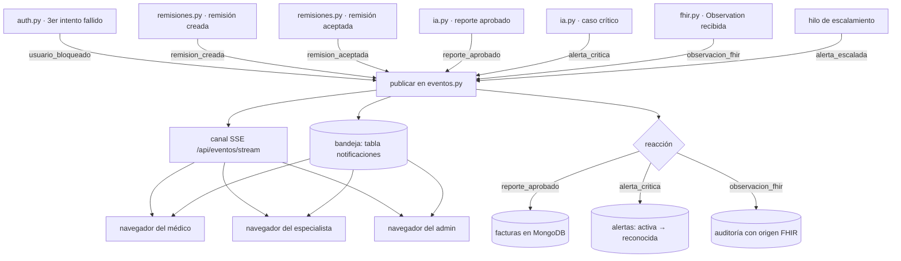

# EVENTOS.md — Catálogo de eventos del sistema reactivo (R19, R20)

Este es el documento que pide R19: **qué evento existe, quién lo dispara, a
quién llega y qué reacción provoca**. Lo escribe la Persona 4 (sistema
reactivo), que es quien implementa las reacciones en `python/eventos.py`.

## Cómo funciona

La regla del equipo es que **el módulo que detecta un hecho NO notifica ni
factura por su cuenta**: llama a `publicar()` y la Persona 4 decide qué pasa.

```python
from eventos import publicar, ids_con_rol

publicar(ids_con_rol(db, "admin"), {
    "tipo": "usuario_bloqueado",
    "mensaje": "La cuenta medico@huv.gov.co se bloqueó por 3 intentos fallidos",
    "usuario_afectado": "medico@huv.gov.co",
})
```

`publicar(destinatarios, evento)` hace tres cosas, en este orden, y **nunca
lanza excepciones** (un aviso fallido no puede tumbar un login ni una remisión):

1. **Reacciona (R19/R20):** según `tipo`, crea la factura automática
   (`reporte_aprobado`), la alerta crítica (`alerta_critica`) o audita el
   origen FHIR (`observacion_fhir`).
2. **Bandea (R18):** guarda una fila en la tabla `notificaciones` por cada
   destinatario. La bandeja sobrevive a recargas y solo el dueño la ve.
3. **Empuja en vivo (R17):** entrega el evento por el canal SSE
   (`GET /api/eventos/stream`) a los destinatarios conectados.

El evento es un dict con `tipo` y `mensaje` (obligatorios) y, cuando aplique,
`paciente_id`, `reporte_id`, `remision_id`, `responsable_id`,
`usuario_afectado`, `nivel`. La `fecha` (ISO, UTC) la agrega `publicar()`.

## Catálogo de eventos

| Evento (`tipo`) | Quién lo dispara | Destinatarios | Reacción automática | Dónde se ve |
|---|---|---|---|---|
| `usuario_bloqueado` | `auth.py` (Persona 1), al 3er intento fallido | todos los `admin` (`ids_con_rol(db, "admin")`) | — (la notificación ES la reacción) | bandeja + canal vivo + toast |
| `remision_creada` | `remisiones.py` (Persona 3), al crear la remisión | el `especialista` que la recibe | — | bandeja + canal vivo |
| `remision_aceptada` | `remisiones.py` (Persona 3), al aceptar | el médico que remitió | — | bandeja + canal vivo |
| `reporte_aprobado` | `ia.py` (Persona 2), al aprobar un reporte | los clínicos (`medico`, `especialista`) | **crea sola la factura** en MongoDB (colección `facturas`) con `reporte_id` y `servicio: "analisis_ia"` (R19) | bandeja + canal vivo + factura en contabilidad |
| `alerta_critica` | `ia.py` (Persona 2), cuando la probabilidad pasa el umbral crítico | los clínicos | **crea la alerta** en estado `activa` (R20) con `responsable_id` si llega | barra de alertas + canal vivo + toast |
| `observacion_fhir` | rest-hook de HAPI (Persona 3), al llegar una `Observation` | el médico responsable | **audita** el evento con origen FHIR (R13) | bandeja + canal vivo + auditoría |
| `alerta_escalada` | `eventos.py` (hilo de escalamiento), si una alerta pasa del plazo sin reconocer | todos los `admin` | marca la alerta como `escalada` (R20) | bandeja + canal vivo + toast |

**Privacidad del canal (R17):** los tipos `remision_creada`, `remision_aceptada`,
`reporte_aprobado`, `alerta_critica`, `alerta_escalada` y `observacion_fhir` son
**clínicos**: aunque un módulo los dirija por error a un `paciente` o a un
`contable`, el canal SSE no se los entrega.

## Flujos automáticos (R19)

| Disparador | Reacción |
|---|---|
| El médico remite un paciente | El especialista recibe notificación (bandeja y canal en vivo). Paciente y contable no reciben nada. |
| El especialista acepta la remisión | El médico remitente recibe notificación. |
| El clínico aprueba un reporte de IA | Se crea sola una factura en MongoDB con `reporte_id`. |
| Una cuenta se bloquea por 3 intentos fallidos | El admin recibe notificación con el usuario afectado. |

## Alertas críticas (R20)

1. `alerta_critica` crea la alerta `activa` (campo `nivel`, por defecto
   `critico`) y la empuja en vivo con un `tipo` que contiene "alerta".
2. En el frontend aparece una **barra persistente** ("N alertas críticas sin
   reconocer") con el detalle desplegable; no se cierra sola.
3. Solo `medico` / `especialista` (y `admin`) la reconocen con una nota
   (`POST /api/alertas/{id}/reconocer`); `paciente` y `contable` reciben 403.
4. La creación y el reconocimiento quedan en la **auditoría**.
5. **Escalamiento:** si nadie la reconoce en `ESCALAMIENTO_SEGUNDOS` (variable
   de entorno, **600 s por defecto**), un hilo interno de la API marca la
   alerta como `escalada` y avisa a los `admin` con el evento
   `alerta_escalada`. En la demo se puede bajar a 15 s para mostrarlo.

## Canal en tiempo real (R17)

- `GET /api/eventos/stream?token=...` (Server-Sent Events, `text/event-stream`).
  El `EventSource` del navegador no envía cabeceras, por eso el token también va
  como parámetro de consulta. Sin token válido: 401.
- Cada evento es un JSON con `tipo`, `mensaje`, `fecha` y `paciente_id` cuando
  aplique (más los datos del hecho). Llega en menos de 8 s desde el hecho, sin
  sondeo; el frontend no hace polling para verlo (solo un respaldo de 60 s).
- Nginx ya tiene `proxy_buffering off` para `/api/eventos/` (sin eso el túnel
  retiene los eventos y el sistema parece lento).
- El servidor responde `: ping` cada 20 s para mantener viva la conexión.

## Contrato de integración para la Persona 2 (IA) y la Persona 3 (flujo clínico)

No hay que tocar `eventos.py`: llamen a `publicar()` desde su módulo, que corre
**dentro del proceso de la API** (importante: solo el proceso de la API puede
entregar eventos en vivo a los navegadores conectados).

```python
# En ia.py — al APROBARSE un reporte de IA (R19: factura automática):
from eventos import publicar, ids_con_rol
publicar(ids_con_rol(db, "medico", "especialista"), {
    "tipo": "reporte_aprobado",
    "mensaje": f"Reporte de IA {reporte_id} aprobado por el clínico",
    "paciente_id": paciente_id,
    "reporte_id": reporte_id,
})

# En ia.py — cuando la probabilidad pasa el umbral crítico (R20):
publicar(ids_con_rol(db, "medico", "especialista"), {
    "tipo": "alerta_critica",
    "mensaje": f"Paciente crítico: glucosa {glucosa} mg/dL con riesgo alto ({prob})",
    "paciente_id": paciente_id,
    "reporte_id": reporte_id,
    "responsable_id": usuario["id"],   # opcional: clínico responsable
    "nivel": "critico",
})

# En remisiones.py — al CREAR la remisión (R19):
publicar(ids_con_rol(db, "especialista"), {
    "tipo": "remision_creada",
    "mensaje": f"Nueva remisión del paciente {paciente_id} a {institucion_destino}",
    "paciente_id": paciente_id,
    "remision_id": remision_id,
})

# En remisiones.py — al ACEPTAR la remisión (R19):
publicar([medico_remitente_id], {
    "tipo": "remision_aceptada",
    "mensaje": f"La remisión {remision_id} fue aceptada",
    "paciente_id": paciente_id,
    "remision_id": remision_id,
})

# En fhir.py (rest-hook de HAPI) — al llegar una Observation (R21/R19):
publicar([medico_responsable_id], {
    "tipo": "observacion_fhir",
    "mensaje": f"Nueva Observation de glucosa (LOINC 2339-0) para el paciente {paciente_id}",
    "paciente_id": paciente_id,
})
```

Detalles del contrato que ya consumen los endpoints de la Persona 4:

- `GET /api/pendientes` cuenta los reportes pendientes buscando una tabla
  llamada `reportes_ia` o `ml_reports` con columna `estado` (`'pendiente'`).
  **Persona 2:** si su tabla se llama distinto, avíselo para ajustar la consulta.
- La factura automática se inserta en la colección **`facturas`** de MongoDB
  (`trazared_huv`) con: `paciente_id`, `servicio: "analisis_ia"`, `valor`
  (variable `VALOR_ANALISIS_IA`, 80000 por defecto), `fecha`, `estado_pago:
  "pendiente"`, `reporte_id` y `origen: "automatico"`. **Persona 3:** su
  `contable_listar` debe leer esta colección; el `valor` lo puede fijar con la
  variable de entorno.

## Diagrama de eventos



## Dónde vive cada cosa

| Pieza | Archivo |
|---|---|
| `publicar()`, reactores, hilo de escalamiento, SSE y endpoints | `python/eventos.py` |
| Tablas `notificaciones` y `alertas` | `db/schema.sql` (sección R18/R20, idempotente) |
| Canal en vivo, bandeja, contadores y alerta desplegable | `frontend/js/eventos.js`, `notificaciones.js`, `alertas.js`, `css/reactivo.css` |
| Ruta SSE sin buffer en nginx | `docker/nginx.conf` (`location /api/eventos/`) |
| Pruebas de este bloque | `pruebas/probar_persona4.py` |
