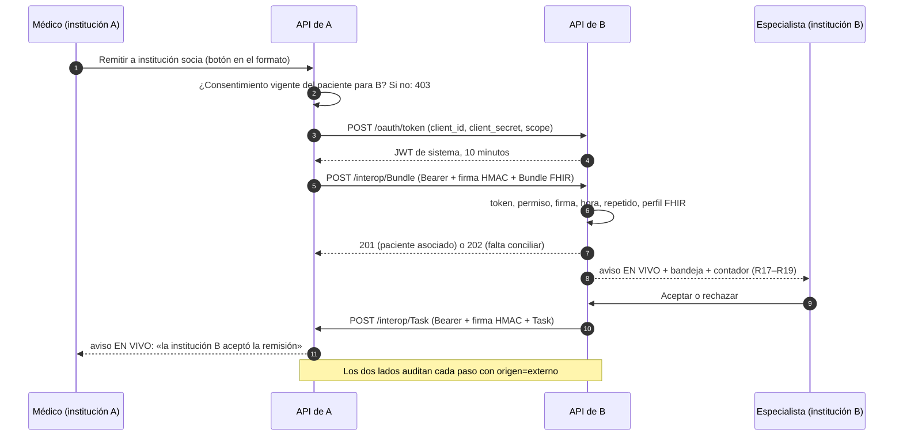

# INTEROP.md — Interoperabilidad entre sistemas (R30 a R33)

Cada equipo es una institución. El médico de una institución remite un paciente al
especialista de la otra, y la información viaja **en FHIR, de API a API**: sin correos,
sin archivos, sin que nadie copie datos a mano.

Este documento es el **contrato** que se le entrega al equipo socio. Lo mismo, en JSON y
siempre al día con el código, está en `GET /api/interop/perfil` (no requiere token).

## 1. El recorrido completo



## 2. Antes de empezar: intercambiar credenciales **en privado**

Cada institución registra a la otra (Admin › **Interoperabilidad** › *Instituciones socias*):

1. **Registrar institución socia.** El sistema genera lo que **ella** usará para entrar aquí:
   `client_id`, `client_secret` y `secreto de firma`. Se muestran **una sola vez**.
2. Entregarle esos tres datos por un canal privado (nunca por el repositorio ni por un chat
   abierto), junto con la URL pública: `https://<tunel>/api`.
3. Recibir los tres datos que **ella** generó para nosotros y registrarlos en *Configurar envío*
   (se guardan cifrados con AES-256-GCM).
4. *Probar conexión*: pide un token al socio y dice si funcionó.

Si un secreto se filtra: *Rotar credenciales*. Borrarlo no basta; los viejos dejan de servir.

Para ensayar **sin el otro equipo**: *Crear socio de prueba (bucle local)*. Este mismo sistema
hace de socio: la remisión sale, entra por `/interop/Bundle` con token y firma reales, el
especialista la responde y la respuesta vuelve por `/interop/Task`.

## 3. Autenticación (R31): un sistema también se identifica

```http
POST /api/oauth/token
Content-Type: application/x-www-form-urlencoded

grant_type=client_credentials&client_id=sis-clinica-socia-1a2b3c&client_secret=...&scope=system/Bundle.write
```

```json
{"access_token": "eyJ...", "token_type": "bearer", "expires_in": 600, "scope": "system/Bundle.write"}
```

| Scope | Abre |
|---|---|
| `system/Bundle.write` | `POST /api/interop/Bundle` · la remisión |
| `system/Task.write` | `POST /api/interop/Task` · la respuesta a una remisión |
| `system/Observation.write` | `POST /api/interop/Observation` · un dato clínico suelto |

El token de sistema lleva `tipo=sistema` y **solo sirve en `/interop/*`**: con él, la API
clínica (`/pacientes`, `/remisiones`…) responde 403. Y un token de usuario no abre `/interop/*`.

## 4. Firma de cada mensaje (R29): quién, qué y cuándo, una sola vez

Cada `POST /interop/...` lleva cuatro cabeceras:

```http
Authorization: Bearer <token de sistema>
X-Timestamp: 1794700000                      ← hora UTC en segundos (epoch)
X-Message-Id: 6f1c2b9e-...                   ← único por mensaje (UUID)
X-Signature: v1=<64 hexadecimales>
Content-Type: application/fhir+json
```

```
firma = HMAC-SHA256( secreto_de_firma,  X-Timestamp + "." + X-Message-Id + "." + cuerpo )
```

El cuerpo es **exactamente** los bytes que se envían (firmar primero, enviar esos mismos bytes).

```python
import hashlib, hmac, json, time, uuid, requests

cuerpo = json.dumps(bundle, ensure_ascii=False, separators=(",", ":")).encode("utf-8")
ts, mid = str(int(time.time())), str(uuid.uuid4())
firma = hmac.new(SECRETO_FIRMA.encode(), f"{ts}.{mid}.".encode() + cuerpo, hashlib.sha256).hexdigest()
requests.post(URL + "/interop/Bundle", data=cuerpo, headers={
    "Authorization": f"Bearer {token}", "Content-Type": "application/fhir+json",
    "X-Timestamp": ts, "X-Message-Id": mid, "X-Signature": f"v1={firma}"})
```

| Qué garantiza | Cómo |
|---|---|
| **Quién** lo envió | Solo el socio conoce el secreto de firma |
| **Qué** envió | Cambiar un carácter del cuerpo rompe la firma → 401 |
| **Cuándo** | `X-Timestamp` debe estar a ±5 minutos de la hora del receptor → si no, 401 |
| **Una sola vez** | Un `X-Message-Id` ya procesado → 409 |

## 5. Lo que responde el receptor: el código le dice al otro qué corregir

| Código | Significa | Qué hace el emisor |
|---|---|---|
| **201** | Aceptado y asociado a un paciente | Nada: quedó |
| **202** | Aceptado; falta conciliar al paciente (el receptor no lo conoce todavía) | Nada: el receptor lo concilia |
| **400** | No es JSON o no es el recurso esperado | Revisar el cuerpo |
| **401** | Sin token, token vencido, firma inválida o mensaje vencido | Pedir token nuevo; revisar secreto, reloj y que se firmen los mismos bytes |
| **403** | Token válido, sin el permiso (`scope`) o sistema desactivado | Pedir el token con el scope correcto |
| **409** | Mensaje repetido | No reenviar: ya se procesó |
| **422** | No cumple el perfil. Va un `OperationOutcome` con **todos** los problemas y **no se guarda nada** | Corregir el recurso y enviar con un `X-Message-Id` nuevo |
| **429** | Demasiadas peticiones | Esperar lo que dice `Retry-After` |

```json
{"resourceType": "OperationOutcome", "issue": [
  {"severity": "error", "code": "invalid",
   "diagnostics": "Observation[2]: el código LOINC '9999-9' no está en el perfil (2339-0, 8480-6, ...)"}]}
```

## 6. Perfil FHIR R4 común (R30)

### Identificador federado: el mismo paciente, sin el documento

`Patient/17` solo existe en una base. Para nombrar al mismo paciente en las dos instituciones
**sin enviar su documento**, ambas calculan:

```
identificador = HMAC-SHA256( secreto federado del acuerdo,  "CC|" + documento sin puntos ni espacios )
```

| | |
|---|---|
| `system` | `urn:salud-digital:sid-federado` (variable `SID_FEDERADO`) |
| Secreto | variable `SECRETO_FEDERADO`, **igual en los dos equipos** (el valor por defecto es el de la demo de clase: cámbienlo) |
| Ejemplo | `CC|1144123456` → `fa0d2121aa10d0c2bb7a5acd8b596f2f…` |

El receptor calcula el mismo HMAC sobre sus pacientes: si coincide, **201**; si no, crea al
paciente como *por conciliar* y responde **202**.

### `POST /interop/Bundle` — la remisión

`Bundle.type = "collection"`. Obligatorios: **un** `Patient` y **un** `ServiceRequest`.

| Recurso | Reglas |
|---|---|
| `Patient` | `identifier` con el identificador federado. `name`, `gender` (`male`/`female`/`other`/`unknown`) y `birthDate`. **Sin** documento, teléfono, correo ni dirección |
| `ServiceRequest` | `status: active`, `intent: order`, `priority` (`routine`/`urgent`/`asap`/`stat`), `code.coding` con **SNOMED CT** (`http://snomed.info/sct`, p. ej. `3457005` remisión del paciente), `identifier[0].value` = número de la remisión en el origen (con él se responde), `reasonCode[].text` = motivo |
| `Observation` (0..n) | `status: final`, `code.coding` con **LOINC** (`http://loinc.org`) del catálogo, `valueQuantity` con `value` numérico y unidad **UCUM** (`system: http://unitsofmeasure.org` + `code`) |
| `DiagnosticReport` (0..1) | **Solo el reporte de IA aprobado por un clínico**: `status: final`. Uno pendiente o rechazado nunca viaja; si llega con otro status → 422 |
| `Consent` (0..1) | `status: active`: la autorización del paciente para compartir con el destinatario |

LOINC aceptados:

| LOINC | Qué es | UCUM |
|---|---|---|
| `8867-4` | Frecuencia cardíaca | `/min` |
| `8480-6` | Presión arterial sistólica | `mm[Hg]` |
| `8462-4` | Presión arterial diastólica | `mm[Hg]` |
| `9279-1` | Frecuencia respiratoria | `/min` |
| `59408-5` / `2708-6` | Saturación de oxígeno | `%` |
| `8310-5` | Temperatura corporal | `Cel` |
| `9269-2` | Escala de Glasgow | `{score}` |
| `2339-0` | Glucosa en sangre | `mg/dL` |

Ejemplo mínimo:

```json
{"resourceType": "Bundle", "type": "collection", "entry": [
  {"resource": {"resourceType": "Patient",
    "identifier": [{"system": "urn:salud-digital:sid-federado", "value": "fa0d2121…"}],
    "name": [{"text": "Ana Ruiz"}], "gender": "female", "birthDate": "1951-03-02"}},
  {"resource": {"resourceType": "ServiceRequest", "status": "active", "intent": "order", "priority": "urgent",
    "identifier": [{"system": "urn:trazared:remision", "value": "REM-2026-000123"}],
    "code": {"coding": [{"system": "http://snomed.info/sct", "code": "3457005", "display": "Remisión del paciente"}]},
    "reasonCode": [{"text": "Neumonía con hipoxemia; requiere UCI"}]}},
  {"resource": {"resourceType": "Observation", "status": "final",
    "code": {"coding": [{"system": "http://loinc.org", "code": "59408-5"}]},
    "valueQuantity": {"value": 86, "unit": "%", "system": "http://unitsofmeasure.org", "code": "%"}}}
]}
```

### `POST /interop/Task` — la respuesta

```json
{"resourceType": "Task", "status": "accepted", "intent": "order",
 "focus": {"identifier": {"system": "urn:trazared:remision", "value": "REM-2026-000123"}},
 "owner": {"display": "Clínica del equipo 3"}, "statusReason": {"text": "Cama UCI disponible"}}
```

`status`: `accepted` · `rejected` · `in-progress` · `completed` · `cancelled`. `focus.identifier.value`
es el número que venía en `ServiceRequest.identifier` de la remisión original.

### `POST /interop/Observation` — un dato suelto

La misma `Observation` del perfil, con `subject.identifier` = identificador federado. Si es
glucosa (`2339-0`) y el valor es crítico (menor de 54 o desde 300 mg/dL), en el receptor nace
una **alerta crítica** que queda activa hasta que un clínico la reconozca (R20).

## 7. Consentimiento y minimización (R32)

- **Sin consentimiento no sale nada.** Antes de enviar, el sistema busca un consentimiento
  vigente del paciente **para esa institución**; si no existe, el envío responde 403 y queda
  auditado (`interop_envio_bloqueado`). El médico lo registra desde el mismo diálogo de envío
  (escrito, verbal o digital) y el paciente puede revocarlo cuando quiera.
- **Solo lo necesario.** El diálogo muestra, antes de enviar, qué viaja y qué **no** sale del
  hospital: documento, teléfono, correo, dirección, EPS, alergias y tipo de sangre.
- El reporte de IA solo viaja si un clínico lo **aprobó**.
- Ley 1581 de 2012: los datos de salud son sensibles (arts. 5 y 6) y su tratamiento exige
  autorización del titular (art. 9).

## 8. Eventos y auditoría

| Evento (`tipo`) | Cuándo | A quién le llega en vivo |
|---|---|---|
| `remision_externa_recibida` | Llegó y se aceptó una remisión del socio | especialistas y admin |
| `respuesta_socio` | El socio aceptó o rechazó una remisión nuestra | el médico que la envió y admin |
| `interop_rechazo` | Se rechazó un mensaje del socio por validación (400/422) | admin |

Auditoría (todas con `origen=externo` y el nombre del socio): `interop_token_emitido`,
`interop_token_rechazado`, `interop_remision_enviada`, `interop_remision_recibida`,
`interop_remision_aceptada` / `_rechazada`, `interop_respuesta_enviada`,
`interop_respuesta_recibida`, `interop_observacion_recibida`, `interop_rechazo`,
`interop_envio_bloqueado`, `consentimiento_registrado`, `consentimiento_revocado`.

La bitácora técnica de cada mensaje (dirección, recurso, código HTTP, detalle) está en
Admin › Interoperabilidad › *Mensajes*.

## 9. La práctica en parejas y la demostración cruzada (R33)

1. **Intercambiar credenciales en privado** (sección 2) y acordar `SECRETO_FEDERADO`.
2. **Enviar tres mensajes en vivo**: una remisión válida (201 o 202), una alterada (401) y una
   con LOINC errado (422).
3. **Correr el tester del otro equipo** contra la URL pública.
4. En la sustentación: el médico de A remite, el especialista de B recibe el aviso sin
   recargar y acepta, el médico de A ve la respuesta sin recargar, y cada admin muestra su
   auditoría y sus mensajes.

Prueba automática de todo el recorrido contra el propio sistema (bucle local):

```bash
docker compose exec api python /app/pruebas/probar_final.py
```

## 10. Variables de entorno

| Variable | Para qué | Si no se define |
|---|---|---|
| `INSTITUCION_NOMBRE` | Nombre con el que este sistema se presenta | `Hospital Universitario del Valle` |
| `SECRETO_FEDERADO` | Secreto del identificador federado (igual en los dos equipos) | el de la demo de clase |
| `SID_FEDERADO` | `system` del identificador federado | `urn:salud-digital:sid-federado` |
| `INTEROP_TOLERANCIA_S` | Diferencia máxima de reloj aceptada | `300` |
| `INTEROP_URL_LOCAL` | URL de este sistema visto desde sí mismo (socio de prueba) | `http://127.0.0.1:8000` |
